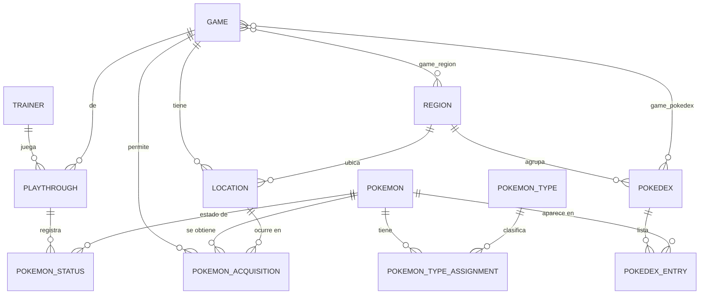

# Bitácora de cambios — MyPokedex API (v4)

> Documento de memoria del proyecto. Registra **reglas de trabajo**, **contexto** (qué es y cómo está armado) y el **historial cronológico** de cambios.
> Regla: cada vez que se modifique código, configuración o estructura, se agrega una entrada nueva al final de la sección [Registro de cambios](#registro-de-cambios). No se borran entradas anteriores.

---

## 1. Reglas de trabajo (obligatorias)

**Alcance: solo `MyPokeDex_v4/api`.** Las demás carpetas del repositorio (`MyPokeDex_v3`, `MyPokeDex/`, etc.) no forman parte del proyecto: no se usan como referencia, no se copian y no se modifican. La v4 **empieza de cero**.

1. **El usuario escribe el código; el agente analiza.** Sin pedido explícito no se crean, editan ni borran archivos de `src/`, `pom.xml` ni configuración. El agente lee, analiza, revisa, explica, propone y documenta.
2. **Excepción única:** el agente solo escribe código cuando el usuario lo pide de forma explícita, por ejemplo ante un error que no logra resolver.
3. **Modo revisión:** al detectar un error se señala el archivo/línea, se explica la causa y se propone la corrección, **sin aplicarla**.
4. **Primero proponer, después ejecutar** (cuando sí haya autorización).
5. **Documentar sí está permitido** sin pedirlo aparte: mantener esta bitácora al día forma parte del trabajo.
6. **Nunca borrar entradas anteriores** de la bitácora; el historial es append-only.
7. Los cambios registrados en la bitácora deben coincidir con lo que realmente se hizo en el código.
8. **Explicar siempre el "por qué".** Todo cambio aprobado se acompaña de la razón de diseño y de la técnica aplicada, porque el proyecto también es un espacio de aprendizaje (ver [Propósito de aprendizaje](#propósito-de-aprendizaje-transversal)).
9. **Ejemplos didácticos sí, edición no.** El agente puede mostrar fragmentos de código en el chat para explicar cómo se hace algo. Mostrarlos es solo enseñanza: no autoriza a modificar los archivos del proyecto.
10. **Re-leer contexto tras inactividad:** si ha pasado un tiempo considerable desde la última consulta al proyecto (nueva sesión de chat, un día o más sin revisar), el agente debe volver a leer `MEMORIA.md` y luego `BITACORA.md` antes de proponer o revisar cualquier cambio. No asumir que el estado del código ni las decisiones pendientes siguen siendo las que se recuerdan; la bitácora es la fuente de verdad del historial y las decisiones tomadas.

---

## 2. Visión del producto

### Objetivo central

Aplicación (API + frontend) de **apoyo para completar la Pokédex de un juego concreto**. El usuario hace *tracking* de los Pokémon que ya atrapó y de los que le faltan, con la información ordenada por juego, Pokédex regional y ruta, para saber **qué le falta y dónde conseguirlo**.

### El problema que resuelve

La Pokédex de un juego **no es** la Pokédex nacional. Cada juego tiene su propia Pokédex regional, y algunos juegos tienen **varias**:

- Ejemplo: **Pokémon Rojo Fuego** tiene **3 Pokédex regionales** (Kanto, Islas Prima/Secunda/Tercera…).
- Ejemplo: **Pokémon Escarlata** tiene su Pokédex de Paldea y sus propias rutas/zonas.

Por eso, filtrar solo por número nacional no sirve para jugar: el usuario necesita saber qué aparece **en su juego**, en **su Pokédex regional** y **en la ruta donde está parado**.

### Propósito de aprendizaje (transversal)

Este proyecto **no es solo un entregable funcional: es un ejercicio de aprendizaje activo**. El objetivo es adquirir criterio y *skills* reales de ingeniería mientras se construye, no solo "que funcione".

Lo que se busca aprender y practicar:

- **Modelado óptimo del dominio**: identificar entidades, relaciones y límites correctos (dónde va `Encounter` y no un campo suelto en `Pokemon`, cuándo usar una tabla puente, cuándo una entidad es en realidad un catálogo).
- **Separación de responsabilidades**: entidad vs. DTO vs. servicio vs. controlador; no exponer entidades JPA directamente.
- **Eficiencia en el acceso a datos**: evitar N+1 (`open-in-view=false` ya obliga a resolverlo bien), usar `fetch join` / `@EntityGraph`, paginación, índices en columnas de filtro, consultas derivadas vs. `@Query` cuando aporte claridad.
- **Eficacia del código**: menos código para el mismo resultado, nombres claros, inmutabilidad donde aplique, sin sobre-ingeniería ni patrones porque sí.
- **Calidad y consistencia**: validación de entrada, manejo de errores uniforme, tests que documenten el comportamiento, convenciones estables.
- **Rendimiento medible**: justificar decisiones con argumentos (o mediciones) y no por intuición.
- **Documentación como hábito**: la bitácora registra la decisión *y* el aprendizaje, para no repetir errores ni redescubrir lo mismo.

Cómo se traduce en la práctica:

1. Antes de escribir código, se discute el modelo y las alternativas (ventajas/costos).
2. Cada cambio explica **qué** se hizo y **por qué** esa forma es mejor que las alternativas.
3. Cuando haya un error o un cuello de botella, se documenta la causa raíz y la técnica usada para resolverlo.
4. Se prioriza entender sobre acumular código: preferible un módulo pequeño, claro y bien modelado que uno grande y frágil.

### Filtros y consultas que debe soportar

| Prioridad | Filtro | Ejemplo |
| --- | --- | --- |
| Principal | **Juego** | Pokémon Escarlata, Rojo Fuego, Esmeralda… |
| Principal | **Pokédex regional** dentro del juego | Rojo Fuego → Kanto / Islas |
| Principal | **Ruta / zona** dentro del juego | "Pokémon que aparecen en la Ruta 1 de Escarlata" |
| Clásico | **Pokédex nacional** (número) | #001 – #151 |
| Clásico | **Nombre** (búsqueda) | "pika" → Pikachu |
| Extra | Tipo y otros (a definir) | tipo fuego, legendarios, etc. |

### Caso de uso principal (tracking)

1. El usuario elige el juego que está jugando.
2. Ve la Pokédex regional correspondiente, con su progreso (capturados / total).
3. Filtra por ruta para saber qué puede atrapar en la zona actual.
4. Marca Pokémon como **capturado**, y el progreso se actualiza.
5. Puede consultar en cualquier momento **qué le falta** y **dónde encontrarlo**.

Estados confirmados por Pokémon dentro de una partida: *sin registrar → visto → capturado* (sin fila = no registrado).

### Modelo de datos conceptual (resumen)

El diseño completo —diagrama, tablas, cardinalidades y decisiones— está en la **[sección 3](#3-modelo-de-datos-diseño-propuesto)**. Resumen del eje:

- `Region` `1—N` `Game` · `Region` `1—N` `Pokedex` (Pokédex **regional**)
- `Game` `N—N` `Pokedex` (versiones emparejadas comparten Pokédex)
- `Pokedex` `1—N` `PokedexEntry` (aquí vive el **número regional**) `N—1` `Pokemon`
- `Region` `1—N` `Location` (ruta/zona) · `Game` `1—N` `PokemonAcquisition` `N—1` `Pokemon` / `N—1` `Location` (cómo y dónde se obtiene)
- `Trainer` `1—N` `Playthrough` (partida) `1—N` `PokemonStatus` (visto/capturado) `N—1` `Pokemon`

> Es una propuesta de diseño: no hay nada implementado más allá de la `Pokemon` esquelética actual.


### Fases sugeridas

| Fase | Contenido | Estado |
| --- | --- | --- |
| 0 | Definición de visión, alcance y contexto | **En curso** |
| 1 | Catálogo de Pokémon (CRUD + búsqueda por nombre/nacional) | Pendiente |
| 2 | Juegos y Pokédex regionales | Pendiente |
| 3 | Rutas y encuentros (qué aparece y dónde) | Pendiente |
| 4 | Tracking del usuario (capturados / faltantes / progreso) | Pendiente |
| 5 | Frontend con filtros combinados | Pendiente |

### Preguntas abiertas

- ¿Los datos de juegos/rutas se cargan a mano, por *seed* o desde una fuente externa (PokéAPI u otra)? **(pendiente)**
- El modelo soporta varias partidas por usuario; falta decidir si el frontend muestra una "partida activa" o todas a la vez. **(pendiente)**
- Login: resuelto por ahora — perfil local sin autenticación (ver [3.9](#39-decisiones-cerradas-2026-10-28)).

---

## 3. Modelo de datos (diseño propuesto)

> **Estado: propuesta para revisión. Nada implementado.** Proyecto nuevo: este modelo se define **desde cero** para la v4 y no depende de ninguna versión anterior. Los nombres de tabla son decisiones propias (ver 3.5).

### 3.1 Principio rector: separar tres mundos

| Mundo | Qué contiene | Entidades | Cambia cuando… |
| --- | --- | --- | --- |
| **Catálogo** | Datos objetivos del juego | `Region`, `Game`, `Pokedex`, `PokedexEntry`, `Pokemon`, `PokemonType` | sale un juego nuevo / se corrige un dato |
| **Obtención** | Dónde y cómo se consigue | `Location`, `PokemonAcquisition` | se descubre o corrige un encuentro |
| **Progreso** | Lo que hizo el jugador | `Trainer`, `Playthrough`, `PokemonStatus` | el jugador juega |

Regla de oro: **el progreso nunca se guarda dentro del catálogo**. Si se mezclan, no se pueden tener dos partidas ni dos usuarios sobre los mismos datos.

### 3.2 Diagrama entidad–relación



### 3.3 Tablas

**Catálogo**

| Tabla | Columnas clave | Restricciones |
| --- | --- | --- |
| `region` | `id`, `name` | `name` UNIQUE |
| `pokemon` | `id`, `name`, `national_dex_number` | `national_dex_number` UNIQUE; índice en `name` |
| `pokemon_type` | `id`, `name` | `name` UNIQUE |
| `pokemon_type_assignment` | `id`, `pokemon_id`, `pokemon_type_id`, `slot` | UQ(`pokemon_id`,`slot`), UQ(`pokemon_id`,`pokemon_type_id`) |
| `game` | `id`, `name`, `slug`, `generation` | `slug` UNIQUE (la región ya no vive aquí: ver `game_region`) |
| `game_region` | `game_id`, `region_id` | PK compuesta; regiones que cubre un juego |
| `pokedex` | `id`, `name`, `slug`, `region_id` | `slug` UNIQUE |
| `game_pokedex` | `game_id`, `pokedex_id` | PK compuesta |
| `pokedex_entry` | `id`, `pokedex_id`, `pokemon_id`, `entry_number` | UQ(`pokedex_id`,`pokemon_id`), UQ(`pokedex_id`,`entry_number`) |

**Obtención**

| Tabla | Columnas clave | Restricciones |
| --- | --- | --- |
| `location` | `id`, `game_id`, `region_id`, `name`, `slug` | UQ(`game_id`,`slug`); FK compuesta (`game_id`,`region_id`) → `game_region`; índice(`game_id`) |
| `obtain_method` | `id`, `code`, `label`, `category`, `display_order` | `code` UNIQUE; `category` ∈ (`WILD`,`SPECIAL`) |
| `pokemon_acquisition` | `id`, `pokemon_id`, `game_id`, `method_id`, `location_id` (nullable), `min_level`, `max_level`, `notes` | índice(`game_id`,`method_id`), índice(`location_id`) |

**Progreso (nuevo en v4)**

| Tabla | Columnas clave | Restricciones |
| --- | --- | --- |
| `trainer` | `id`, `name`, `slug` | `slug` UNIQUE (perfil local, sin login por ahora) |
| `playthrough` | `id`, `trainer_id`, `game_id`, `status`, `nickname`, `started_at`, `finished_at` | índice(`trainer_id`, `status`) |
| `pokemon_status` | `id`, `playthrough_id`, `pokemon_id`, `status`, `caught_at`, `notes` | UQ(`playthrough_id`,`pokemon_id`), índice(`playthrough_id`,`status`) |

> `pokemon_status` **no** guarda la ubicación de captura en el MVP; se evaluará más adelante (requiere migración, no cambia el resto del modelo).

Enums: `ObtainMethod` (`WILD`, `STATIC_ENCOUNTER`, `EVOLUTION`, `GIFT`, `TRADE`, `FOSSIL`, `GAME_CORNER`, `EVENT`), `DexStatus` (`SEEN`, `CAUGHT`) y `PlaythroughStatus` (`ACTIVE`, `COMPLETED`, `ABANDONED`). Todos con `@Enumerated(EnumType.STRING)`.

### 3.4 Cardinalidades y por qué

| Relación | Cardinalidad | Razón |
| --- | --- | --- |
| `Region` → `Game` | 1—N | un juego pertenece a una región (Kanto, Paldea…) |
| `Region` → `Pokedex` | 1—N | una región puede tener varias Pokédex (Rojo Fuego tiene 3) |
| `Game` ↔ `Pokedex` | **N—N** | las versiones emparejadas comparten las mismas Pokédex |
| `Pokedex` → `PokedexEntry` | 1—N | la entrada es la lista; aquí vive el **número regional** |
| `Pokemon` → `PokedexEntry` | 1—N | un Pokémon tiene un número distinto en cada Pokédex, y puede no aparecer en algunas |
| `Region` → `Location` | 1—N | una ruta física existe una vez y se reutiliza en los juegos de esa región |
| `Game` → `PokemonAcquisition` | 1—N | los encuentros cambian por versión (exclusivos) |
| `Pokemon` → `PokemonAcquisition` | 1—N | un Pokémon se obtiene de muchas formas |
| `Location` → `PokemonAcquisition` | 1—N (nullable) | hay obtenciones sin ruta (regalo, intercambio, evolución) |
| `Trainer` → `Playthrough` | 1—N | una persona puede tener varias partidas |
| `Playthrough` → `PokemonStatus` | 1—N | el estado es **por partida**, no global |
| `Pokemon` → `PokemonStatus` | 1—N | el mismo Pokémon tiene estado en cada partida |

**El progreso de una Pokédex no se almacena**: se calcula contando las `PokedexEntry` de esa Pokédex que tengan `PokemonStatus = CAUGHT` en la partida activa.

### 3.5 Decisiones de diseño (con alternativa descartada)

| # | Decisión | Alternativa descartada y por qué no |
| --- | --- | --- |
| D1 | El **número regional** vive en `pokedex_entry`, no en `pokemon` | Ponerlo en `pokemon` obliga a un número por Pokémon y rompe con las 3 Pokédex de Rojo Fuego y con especies ausentes de una Pokédex. |
| D2 | `Game` ↔ `Pokedex` es **N—N** | FK `game_id` en `pokedex` duplicaría 150–400 entradas por cada versión emparejada (Rojo/Verde Hoja, Escarlata/Púrpura). |
| D3 | `Game` = **versión jugable** (Rojo Fuego, no la familia) | Modelar la familia obliga a una tabla extra y no resuelve los exclusivos por versión. La familia se puede derivar luego con `generation`. |
| D4 | `Location` cuelga de **`Game`** (decisión del usuario, 2026-10-29) | Colgarla de `Region` ahorra duplicar "Ruta 1", pero pierde el dato que hace útil el filtro: los encuentros son **por juego**. La Ruta 1 de Rojo Fuego y la de Esmeralda no comparten especies ni niveles. Coste asumido: "Ruta 1" existe una vez por juego; la región se deriva de `Game.region`. |
| D5 | La obtención es una **entidad** (`PokemonAcquisition`), no un M—N `Location`↔`Pokemon` | Un M—N plano no puede guardar método, niveles ni notas, y no admite obtenciones sin ruta (regalo, intercambio, evolución). |
| D6 | El estado cuelga de **`Playthrough`**, no de `Pokedex` ni de `PokedexEntry` | Guardarlo en la entrada de Pokédex impide tener 2 partidas o 2 usuarios, y duplica el estado si un Pokémon está en 2 Pokédex. |
| D7 | `Playthrough` en lugar de "usuario + juego" | Permite reiniciar el juego sin perder el historial y comparar partidas. |
| D8 | Tipos como **entidad + asignación con `slot`** | Un `@ElementCollection` de enums no permite ordenar los 2 tipos ni traducir nombres; un M—N plano no puede imponer UQ por slot. |
| D9 | Solo se guardan filas para **visto/capturado**; "no registrado" = sin fila | Ahorra cientos de miles de filas y hace trivial el cálculo de faltantes. |
| D10 | Enums como **STRING** | `ORDINAL` se rompe si se reordena el enum y hace ilegible la BD. |
| D11 | `ObtainMethod` como **tabla catálogo**, no enum | Un enum no puede filtrar por *categoría* en JPQL (la categoría es un atributo Java, no una columna) y añadir un método exige recompilar. Con tabla, `where m.category = :cat` es una consulta y el front lista los filtros desde `GET /methods`. |
| D12 | `Game` ↔ `Region` es **N-N** (`game_region`); `Game.region` desaparece | Un juego puede cubrir varias regiones (Oro/Plata: Johto y Kanto; Escarlata/Púrpura: Paldea, Noroteo y Unova por DLC). Una FK simple obliga a mentir o duplicar el juego. Además permite FK compuesta en `location` para que una ruta no pueda pertenecer a una región que el juego no cubre. |

### 3.6 Reglas de mapeo JPA

1. **`FetchType.LAZY` + `optional = false`** en toda FK obligatoria; `open-in-view=false` ya está activo, así que cada consulta debe traer explícitamente lo que necesita (`@EntityGraph` o *fetch join*).
2. **Unidireccional por defecto.** Solo mapear la colección inversa si de verdad se recorre; si es bidireccional, usar `mappedBy` y un helper `addX()` que mantenga ambos lados.
3. **`cascade = ALL` + `orphanRemoval = true`** únicamente en composiciones reales (`Pokemon.typeAssignments`, `Playthrough.statuses`). **Nunca** desde el catálogo hacia el progreso: borrar un `Game` no debe borrar partidas.
4. **`equals`/`hashCode` por `id`** (`@EqualsAndHashCode(onlyExplicitlyIncluded = true)`); nunca comparar entidades por todos los campos.
5. **Restricciones en la BD**, no solo en el servicio: UNIQUE, índices en columnas de filtro (`game_id, method`; `playthrough_id, status`; `pokemon.name`).
6. **DTOs siempre**: las entidades no salen del servicio (evita ciclos de Jackson y *lazy exceptions*).
7. **`@Transactional(readOnly = true)`** en lecturas; escritura solo en los métodos que mutan.
8. **`Long` + `IDENTITY`** como PK por simplicidad en MySQL (nota: IDENTITY impide *batch insert*; aceptable para este volumen).

### 3.7 Anti-patrones prohibidos en este proyecto

- `@Data` en entidades → genera `toString`/`equals` sobre relaciones lazy (rompe y dispara consultas).
- `FetchType.EAGER` "para que funcione" → mata el rendimiento; se resuelve con `@EntityGraph` o proyección.
- Guardar contadores de progreso (`totalCaught`) → se desincronizan; se calculan.
- `@GeneratedValue` en un campo que no es la PK (bug actual de la v4 en `nationalDexnumber`).
- M—N sin entidad intermedia cuando hay atributos (caso `Location`↔`Pokemon`).
- Exponer entidades directamente en el `Controller`.
- `CascadeType.REMOVE` desde `Pokemon` hacia `PokemonAcquisition`/`PokemonStatus`.

### 3.8 Alcance del proyecto

- **Solo existe la v4.** `MyPokeDex_v4/api` es el proyecto. Las demás carpetas (`MyPokeDex_v3`, `MyPokeDex/`, cualquier otra) no tienen relación con él y quedan fuera de alcance: no se usan como referencia, no se copian y no se modifican.
- **Se empieza de cero.** El modelo de la sección 3 se justifica por sus propias decisiones (3.5), no por continuidad con versiones anteriores. Cualquier parecido con algo previo es coincidencia de dominio, no herencia.
- **No hay código previo que reutilizar.** Lo único existente son los cuatro esqueletos de `pokemon/` (`Pokemon`, `PokemonRepository`, `PokemonService`, `PokemonController`, estos tres últimos vacíos) y `MypokedexApiApplication`.
- **La carpeta local se llama `MyPokeDex_v4`; el módulo es `api`.** No hay que confundir "v4" con una versión incremental sobre las anteriores: es un proyecto independiente.

### 3.9 Decisiones cerradas (2026-10-28)

| # | Pregunta | Decisión |
| --- | --- | --- |
| 1 | `Game` = versión o familia | **Versión** (Rojo Fuego es un `game`). Rojo/Verde Hoja comparten Pokédex mediante el N—N; los exclusivos se resuelven en la obtención. |
| 2 | Login | **No por ahora.** `trainer` es un perfil local sin autenticación. Cuando se agregue seguridad, solo se añaden credenciales a `trainer`, sin tocar relaciones. |
| 3 | Estados | **`SEEN` + `CAUGHT`.** Ausencia de fila = no registrado (no se guardan estados vacíos). |
| 4 | Ubicación de captura | **Fuera del MVP.** `pokemon_status` no lleva `location_id`. Se agrega después si se quiere historial de dónde se atrapó. |
| 5 | Formas regionales | **No.** `pokemon` = especie. Si se necesitan, se crea `pokemon_form` y el número nacional se mueve a ese nivel. |

### 3.10 Orden de implementación y checklist de revisión

El código lo escribe el usuario; esta lista sirve para implementar y para que el agente revise.

**Guía paso a paso con comandos, verificaciones y errores típicos:** [`GUIA_IMPLEMENTACION.md`](GUIA_IMPLEMENTACION.md).

**Verificación en esta etapa:** desde Spring Boot (compilar, arrancar y leer el DDL de Hibernate en consola). No se ejecuta SQL manual ni se crean tablas a mano.

**Orden por dependencias** (cada paso debe compilar y arrancar antes del siguiente):

1. `Region`
2. `Pokemon` (corregida) → `PokemonType` → `PokemonTypeAssignment`
3. `Game` → `Pokedex` → `game_pokedex`
4. `PokedexEntry`
5. `Location`
6. `ObtainMethod` → `PokemonAcquisition`
7. `DexStatus`, `PlaythroughStatus` → `Trainer` → `Playthrough` → `PokemonStatus`

**Checklist por entidad:**

- [ ] `@Table(name = "...")` explícito, en `snake_case`.
- [ ] `@Column(nullable = false)` en lo obligatorio y `length` en los `String`.
- [ ] UNIQUE compuestos declarados con `@UniqueConstraint(name = ..., columnNames = ...)`.
- [ ] FK con `@ManyToOne(fetch = FetchType.LAZY, optional = false)` + `@JoinColumn(name = ..., nullable = false)`.
- [ ] Enums con `@Enumerated(EnumType.STRING)`.
- [ ] `@EqualsAndHashCode(onlyExplicitlyIncluded = true)` con `@EqualsAndHashCode.Include` en `id`.
- [ ] Sin `@Data`, sin `toString` sobre relaciones, sin `EAGER`.
- [ ] `pokemon.national_dex_number` **UNIQUE** y **sin** `@GeneratedValue`.
- [ ] Arranque limpio y tablas creadas con las FK e índices esperados (`show-sql=true`).

> Nota de escalabilidad: `ddl-auto=update` sirve para avanzar, pero no renombra ni borra columnas de forma segura. Cuando el modelo se estabilice, conviene pasar a migraciones versionadas (Flyway o Liquibase).

---

## 4. Contexto técnico

| Dato | Valor |
| --- | --- |
| Proyecto | MyPokedex — API REST |
| Versión | v4 (`MyPokeDex_v4`) — proyecto independiente, empieza de cero |
| Alcance | **solo** `MyPokeDex_v4/api`; las demás versiones no se tocan |
| Ruta del módulo | `DesarrolloWeb/Api-proyectos/Proyecto MyPokedex/MyPokeDex_v4/api` |
| Repo Git | `F:\Jason Molinares\MyGitHub` (la v4 vive dentro de este repo) |
| Lenguaje / JDK | Java 25 |
| Framework | Spring Boot 4.1.2 (`spring-boot-starter-webmvc`, `spring-boot-starter-data-jpa`) |
| Build | Maven (`mvnw` / `mvnw.cmd`) |
| Base de datos | MySQL 8 local, esquema `mypokedexv1` |
| Utilidades | Lombok (con `annotationProcessorPaths` configurado en el POM) |
| Paquete base | `com.mypokedex.api` |

### Configuración relevante (`src/main/resources/application.properties`)

- `spring.application.name=mypokedex`
- Datasource: `jdbc:mysql://localhost:3306/mypokedexv1`, usuario `root`, sin password.
- JPA: `ddl-auto=update`, `show-sql=true`, `format_sql=true`, `open-in-view=false`, `default_batch_fetch_size=50`.
- `server.error.include-message=always`.

### Estructura actual

```
api/
├── BITACORA.md                  <- este documento
├── GUIA_IMPLEMENTACION.md       <- guía paso a paso (para el usuario)
├── HELP.md
├── pom.xml
├── mvnw / mvnw.cmd
└── src/
    ├── main/
    │   ├── java/com/mypokedex/api/
    │   │   ├── MypokedexApiApplication.java
    │   │   └── pokemon/
    │   │       ├── controller/PokemonController.java
    │   │       ├── model/
    │   │       │   ├── dto/            (vacío)
    │   │       │   ├── entity/Pokemon.java
    │   │       │   └── enums/          (vacío)
    │   │       ├── repository/PokemonRepository.java
    │   │       └── service/PokemonService.java
    │   └── resources/
    │       ├── application.properties
    │       ├── static/                 (vacío)
    │       └── templates/              (vacío)
    └── test/java/com/mypokedex/api/MypokedexApiApplicationTests.java
```

### Estado del código (proyecto nuevo)

- `MypokedexApiApplication`: clase `@SpringBootApplication` estándar, funcional.
- `Pokemon` (entidad JPA): tiene `id` (PK, IDENTITY), `name` y `nationalDexnumber`. Usa Lombok (`@Getter`, `@Setter`, `@NoArgsConstructor`).
- `PokemonController`, `PokemonService`, `PokemonRepository`: **esqueletos vacíos**, sin anotaciones ni lógica.
- Carpetas `dto` y `enums`: creadas pero sin archivos.
- No hay nada más: la v4 no arrastra código de versiones anteriores.

### Observaciones / pendientes detectados

1. **`Pokemon.nationalDexnumber`**: tiene `@GeneratedValue` en un campo que no es `@Id`. Hibernate no lo admite como campo generado y es probable que falle al arrancar (`@GeneratedValue` solo aplica a la PK). Debe quitarse la anotación; si se quiere que sea único, usar `unique = true`.
2. **`Pokemon`** no declara `@Table(name = "...")`; Hibernate usará `pokemon` por defecto. Confirmar si ese es el nombre deseado.
3. **`PokemonRepository`** no extiende `JpaRepository<Pokemon, Long>`, por lo que no es un bean administrado por Spring todavía.
4. **`PokemonController` / `PokemonService`** no están anotados (`@RestController`, `@Service`) y no tienen inyección de dependencias.
5. No hay manejo global de errores (`@RestControllerAdvice`), ni validación (`spring-boot-starter-validation` no está en el POM).
6. La v4 **no está commiteada completa**: `pom.xml`, `mvnw`, `application.properties`, tests y la clase `Application` están como *untracked* en Git; los archivos de `pokemon/*` están en *staging* con modificaciones pendientes.
7. **Higiene de Git:** la carpeta `MyPokeDex/` ya no existe en disco, pero el índice conserva entradas fantasma (`AD MyPokeDex/...`). Se limpian desde `MyPokeDex_v4` con `git rm -r --cached MyPokeDex`. El índice también tiene archivos de `MyPokeDex_v3` en staging, que no pertenecen a esta versión.
8. **Nombre de la base:** `application.properties` apunta a `mypokedexv1`. No hace falta cambiarlo: Hibernate crea las tablas ahí. Si algún día se quiere otro nombre, es solo cambiar la URL (y que la base exista, o añadir `createDatabaseIfNotExist=true`). No se toca en esta etapa.
9. **Servidor de BD antiguo (importante):** en el primer arranque Hibernate avisa `HHH000511: The 5.5.5 version for [org.hibernate.dialect.MySQLDialect] is no longer supported... minimum 8.0.0`. El servidor reporta **5.5.5**, que es lo típico de **MariaDB** (se anuncia con ese prefijo por compatibilidad) o de un MySQL viejo. Con dialecto MySQL 8 sobre un servidor anterior, el DDL puede fallar o comportarse raro (`datetime(6)`, constraints, colaciones). Opciones: usar `MariaDBDialect` + driver de MariaDB, o actualizar el servidor. Es decisión del usuario y no bloquea las entidades simples.

> Ninguna de estas observaciones se ha corregido: por la regla 1, quedan solo documentadas hasta que el usuario lo pida.

---

## 5. Convención de la bitácora

Cada entrada lleva:

- **Fecha** (AAAA-MM-DD) y **título corto**.
- **Objetivo**: qué se quería lograr.
- **Cambios**: archivos tocados y qué se hizo.
- **Decisiones**: criterios tomados y por qué (para no repetir discusiones).
- **Aprendizaje**: técnica, patrón o criterio de diseño aplicado y qué se aprendió con ello (obligatorio cuando hubo código involucrado).
- **Pendientes / siguientes pasos**: lo que queda abierto.

---

## 6. Registro de cambios

### 2026-10-28 — Creación de la bitácora y levantamiento de contexto

**Objetivo:** dejar memoria escrita del estado del proyecto antes de empezar a modificarlo.

**Cambios:**
- Se creó `api/BITACORA.md` con la estructura anterior (contexto, estructura, estado del código, observaciones y registro de cambios).

**Decisiones:**
- La bitácora vive dentro del módulo `api/` para que acompañe al código y se versione junto con él.
- Se usa un solo archivo con contexto fijo arriba e historial append-only abajo, en vez de un `CHANGELOG.md` puro, para que sirva también como contexto de trabajo.
- Se documenta en español, igual que los comentarios existentes del proyecto.

**Pendientes / siguientes pasos:**
- Completar la capa `repository` → `service` → `controller` para `Pokemon`.
- Corregir el `@GeneratedValue` de `nationalDexnumber` antes de levantar la app.
- Definir el contrato de la API (endpoints, DTOs de request/response) y documentarlo aquí.

---

### 2026-10-28 — Regla de trabajo + definición de visión y alcance

**Objetivo:** fijar como memoria permanente que el agente **no modifica código sin pedido explícito**, y dejar documentado el inicio del proyecto con su propósito real.

**Cambios (solo documentación, cero código tocado):**
- Nueva sección **1. Reglas de trabajo**, con la regla principal: no modificar código salvo pedido explícito.
- Nueva sección **2. Visión del producto**: objetivo, problema (Pokédex regional vs. nacional, juegos con varias Pokédex como Rojo Fuego), filtros requeridos (juego → Pokédex regional → ruta, más nacional/nombre), caso de uso de tracking, modelo conceptual y fases.
- Renumeración del resto de secciones.
- Nota explícita en las observaciones: siguen solo documentadas, sin corregir.

**Decisiones:**
- Se deja escrito que "documentar" es la única acción permitida sin pedido previo.
- Se asume el orden de filtros **juego → Pokédex regional → ruta/zona** como eje del producto; nacional y nombre quedan como búsquedas de apoyo.
- El modelo de datos de la sección 2 es **un borrador para discutir**, no un compromiso de implementación.

**Pendientes / siguientes pasos:**
- Cerrar las preguntas abiertas (login, origen de los datos, uno o varios juegos activos).
- Validar el modelo conceptual: `Game`, `RegionalPokedex`, `PokedexEntry`, `Location`, `Encounter`, `CaughtEntry`.
- No se inicia implementación hasta que el usuario lo indique.

---

### 2026-10-28 — Se agrega el propósito de aprendizaje como eje del proyecto

**Objetivo:** dejar escrito que el proyecto también tiene una finalidad formativa: aprender mientras se avanza, adquiriendo criterio para modelar el dominio de forma óptima y técnicas para que el código sea lo más eficiente y eficaz posible.

**Cambios (solo documentación, cero código tocado):**
- Nueva subsección **"Propósito de aprendizaje (transversal)"** dentro de la visión, con las habilidades a practicar (modelado, separación de responsabilidades, eficiencia en datos, eficacia, calidad, rendimiento medible, documentación) y cómo se traduce en la práctica.
- Nueva regla **6** en Reglas de trabajo: explicar siempre el *por qué* de cada cambio.
- La convención de la bitácora ahora exige un campo **"Aprendizaje"** en cada entrada donde hubo código.

**Decisiones:**
- El aprendizaje se trata como **requisito transversal**, no como algo opcional al final: condiciona la forma de proponer, implementar y documentar.
- Se prioriza **entender sobre acumular código** y evitar sobre-ingeniería; el criterio se justifica, no se impone.

**Pendientes / siguientes pasos:**
- Aplicar el criterio en la próxima decisión de modelado (validación del modelo conceptual con ventajas y costos de cada alternativa).

---

### 2026-10-28 — Diseño de las relaciones de base de datos (propuesta, sin implementar)

**Objetivo:** definir el modelo relacional completo de la v4 —catálogo, obtención y tracking— antes de escribir entidades, justificando cada relación.

**Cambios (solo documentación, cero código tocado):**
- Nueva **sección 3 "Modelo de datos (diseño propuesto)"**: principio de los tres mundos, diagrama ER, tablas con columnas y restricciones, cardinalidades, 10 decisiones con su alternativa descartada, reglas de mapeo JPA, anti-patrones, herencia de la v3 y preguntas a cerrar.
- La sección de modelo conceptual de la visión ahora resume y enlaza a la sección 3.
- Renumeración de las secciones siguientes (Contexto técnico → 4, Convención → 5, Registro → 6).

**Decisiones clave:**
- El **número regional** va en `pokedex_entry`, nunca en `pokemon` (D1).
- `game` ↔ `pokedex` es **N—N**, porque las versiones emparejadas comparten Pokédex (D2).
- `game` representa una **versión** jugable, no la familia (D3).
- `location` cuelga de `region`, no de `game`, para no duplicar rutas (D4).
- La obtención es entidad (`pokemon_acquisition`) porque tiene atributos y admite casos sin ruta (D5).
- El progreso cuelga de **`playthrough`** (partida), no del catálogo; se calcula, no se guarda (D6, D7).
- Se reutiliza el modelo ya probado de la v3 y se agrega `trainer` + `playthrough` + `pokemon_status`.

**Aprendizaje:**
- **Separar catálogo / obtención / progreso** evita mezclar datos objetivos con datos del jugador; es la decisión que más impacta el resto del diseño.
- Un M—N solo sirve cuando la relación no tiene atributos; si los tiene, se promueve a entidad (patrón *association entity*).
- Poner el número regional en `pokemon` es el error clásico de este dominio: el número es relativo a la Pokédex, no a la especie.
- Normalizar `location` por región demuestra el compromiso entre evitar duplicación (D4) y asumir una regla de negocio (validar región del juego).

**Pendientes / siguientes pasos:**
- Confirmar las 5 preguntas de la sección 3.9 antes de mapear entidades.
- Cuando se apruebe: corregir `Pokemon` (quitar `@GeneratedValue` de `nationalDexnumber`, agregar `@Table`/UNIQUE) y crear las entidades en orden de dependencias (`Region` → `Pokemon`/`PokemonType` → `Game`/`Pokedex` → `PokedexEntry` → `Location` → `PokemonAcquisition` → `Trainer`/`Playthrough`/`PokemonStatus`).
- No se escribe código hasta que el usuario lo pida.

---

### 2026-10-28 — Decisiones del modelo cerradas y cambio de dinámica de trabajo

**Objetivo:** cerrar las dudas del diseño y dejar explícito que el usuario escribe el código.

**Cambios (solo documentación, cero código tocado):**
- **Reglas de trabajo reescritas:** el usuario escribe el código; el agente analiza, revisa, explica y documenta. El agente solo escribe si se le pide explícitamente (caso típico: un error que el usuario no logra resolver). En revisión se señala y se propone, no se aplica.
- **3.9** pasó de "Preguntas a cerrar" a **"Decisiones cerradas"**: `Game` = versión; sin login por ahora; estados `SEEN` + `CAUGHT`; ubicación de captura fuera del MVP; sin formas regionales.
- **Modelo ajustado:** se quitó `location_id` de `pokemon_status` y su relación en el diagrama ER.
- **Nueva 3.10:** orden de implementación por dependencias y checklist de revisión por entidad.
- **Visión:** la línea de estados ya no dice "a confirmar"; las preguntas abiertas se reducen a origen de datos y partida activa vs. varias.

**Decisiones:**
- El *tracking* mínimo (estado + fecha + notas) alcanza para el objetivo; la ubicación de captura es un extra que agrega una FK y una validación sin aportar al "qué me falta".
- Diferir el login no afecta el modelo: añadir credenciales a `trainer` después no rompe ninguna relación.
- Se mantiene `ddl-auto=update` para iterar, con nota de migrar a Flyway/Liquibase al estabilizar.

**Aprendizaje:**
- Diferir una funcionalidad sin romper el modelo es señal de que las entidades están bien separadas: cada "después" queda como columna o tabla nueva, no como rediseño.
- El checklist de revisión convierte el diseño en criterios verificables; sirve tanto para escribir como para auditar.

**Pendientes / siguientes pasos:**
- El usuario implementará las entidades en el orden de 3.10; el agente revisará cada avance y señalará desviaciones del checklist.
- Siguen abiertas: origen de los datos (seed vs. fuente externa) y si el frontend usará una partida activa o varias visibles.

---

### 2026-10-28 — Guía de implementación paso a paso

**Objetivo:** dar al usuario un recorrido concreto para escribir las entidades sin perderse, con verificaciones y errores típicos.

**Cambios (solo documentación, cero código tocado):**
- Nuevo **`GUIA_IMPLEMENTACION.md`**: requisitos previos, 9 pasos (0 a 8), criterios de "paso terminado", tabla de errores típicos, cómo pedir revisión y plan de sesiones.
- Enlazado desde la sección 3.10 y agregado al árbol de estructura de esta bitácora.

**Decisiones:**
- La guía va en archivo aparte porque es un documento vivo (se actualiza al avanzar), mientras la bitácora es append-only.
- Se antepone el arreglo de `Pokemon` (Paso 1) al resto: es el bug que puede impedir el arranque y bloquea la verificación de todo lo demás.
- La base se crea en `utf8mb4` para no perder acentos en nombres como "Pokémon" o "Islas Prima".
- Cada paso exige probar una restricción a mano (un insert que debe fallar y otro que debe pasar), no solo compilar.

**Aprendizaje:**
- `ddl-auto=update` nunca renombra ni borra columnas: por eso el renombre de `nationalDexnumber` puede dejar una columna huérfana y por eso se recomienda Flyway al estabilizar.
- "Paso terminado" se define con evidencia verificable (arranque + `SHOW CREATE TABLE` + prueba de restricción), no con "ya compila".

**Pendientes / siguientes pasos:**
- El usuario ejecuta el Paso 0 (base `utf8mb4`, arranque de diagnóstico, commit de línea base) y el Paso 1.
- Al terminar cada paso, comparte archivos + `SHOW CREATE TABLE` para revisión.

---

### 2026-10-28 — Corrección de alcance: solo la v4, proyecto desde cero

**Objetivo:** dejar claro que el trabajo ocurre únicamente en `MyPokeDex_v4` y que las demás versiones no tienen relación con el proyecto.

**Cambios (solo documentación, cero código tocado):**
- **Regla de alcance** al inicio de las Reglas de trabajo: solo `MyPokeDex_v4/api`; las demás carpetas no se usan como referencia, no se copian y no se modifican.
- **3.8 reescrita**: pasó de "Herencia de la v3" a **"Alcance del proyecto"**, dejando explícito que el modelo se define desde cero y se justifica por sus propias decisiones (3.5).
- **Contexto técnico**: nueva fila "Alcance" y versión marcada como proyecto independiente.
- **"Estado del código (proyecto nuevo)"**: se aclara que no hay nada más que los cuatro esqueletos y la clase `Application`, sin arrastre de versiones anteriores.
- **Observación 7 corregida**: la carpeta `MyPokeDex/` no existe en disco; son entradas fantasma en el índice (`AD`). Se limpian con `git rm -r --cached MyPokeDex`. La v3 también tiene staging, pero queda fuera de alcance y no se toca.
- **Observación 8 nueva**: `application.properties` apunta a `mypokedexv1`; si se quiere una BD limpia, renombrarla y actualizar la URL (lo decide el usuario).
- **Guía**: Paso 0.1 ahora permite elegir el nombre de la BD y Paso 0.3 explica cómo limpiar el índice fantasma; se eliminó la referencia a la v3 en el Paso 1.

**Decisiones:**
- No se reutiliza código ni nombres "porque existían antes": si un nombre se mantiene (`pokedex`, `pokedex_entry`, `pokemon_acquisition`), es porque se justifica en 3.5, no por continuidad.
- El alcance se declara como regla, no como comentario, para que no se vuelva a mezclar con otras versiones.
- No se toca el staging de `MyPokeDex_v3`: es otro proyecto y la decisión sobre su Git corresponde al usuario.

**Aprendizaje:**
- Un proyecto "nuevo" puede compartir dominio con uno anterior sin ser su continuación; conviene declarar el alcance por escrito para no arrastrar decisiones viejas sin cuestionarlas.
- `git rm --cached` desvincula del índice sin borrar archivos: la forma correcta de limpiar carpetas fantasma sin perder nada.

**Pendientes / siguientes pasos:**
- Ejecutar el Paso 0 con el nombre de BD elegido.
- A partir de aquí, toda referencia al proyecto es exclusivamente `MyPokeDex_v4/api`.

---

### 2026-10-28 — Enfoque en Spring Boot: verificación por consola, sin trabajo manual de BD

**Objetivo:** dejar de trabajar la base de datos a mano y concentrarse en Spring Boot, aprovechando que `ddl-auto=update` genera el esquema a partir de las entidades.

**Cambios (solo documentación, cero código tocado):**
- **`GUIA_IMPLEMENTACION.md` reescrita** con enfoque Spring: ciclo `escribir entidad → compile → spring-boot:run → leer consola → commit`; se eliminaron los pasos de SQL manual y las verificaciones con `SHOW CREATE TABLE`.
- **Paso 0** ahora es "línea base": leer el arranque, opcionalmente activar `logging.level.org.hibernate.tool.schema=DEBUG` para ver el DDL, limpiar el índice fantasma y commitear.
- **Definition of Done** acortada a cuatro criterios: compila, arranca (`Started MypokedexApiApplication`), el DDL esperado aparece en consola, y commit. La prueba real de constraints se pospone a cuando existan repositorios y tests.
- **Errores típicos** reordenados por lo que se ve en consola (incluye `Unknown database` y `AnnotationException`).
- **Observación 8** reformulada: no hace falta renombrar la base; se deja `mypokedexv1`.
- **3.10**: se aclara que la verificación es por consola de Spring.

**Decisiones:**
- El esquema (tablas y constraints) lo gobierna Hibernate; la base en sí no la crea. Como la app ya arrancó, ese punto está resuelto.
- No se ejecuta SQL manual en esta etapa; si se necesita ver algo, se activa el log de esquema.
- Se mantiene `ddl-auto=update` para iterar rápido; la migración a Flyway/Liquibase queda para cuando el modelo se estabilice.

**Aprendizaje:**
- `ddl-auto=update` crea **tablas**, no la base de datos: la confusión es común y conviene tenerla clara.
- Verificar leyendo el DDL que genera Hibernate es más rápido que inspeccionar la BD, pero no prueba las restricciones; eso requiere insertar datos (repositorios/tests).
- `@GeneratedValue` fuera del `@Id` se delata en el DDL (`auto_increment` donde no debe) aunque la app arranque.

**Pendientes / siguientes pasos:**
- Revisar el arranque actual: confirmar que `pokemon` se creó y que `national_dex_number` **no** quedó como `auto_increment`.
- Si está mal, ejecutar el Paso 1; si está bien, seguir con `Region`.
- El usuario sigue escribiendo el código; el agente revisa consola + entidades.

---

### 2026-10-28 — Análisis del primer arranque

**Objetivo:** interpretar el log de arranque antes de seguir con las entidades.

**Cambios (documentación):**
- **Observación 9**: el servidor reporta 5.5.5 y Hibernate avisa que el dialecto MySQL no está soportado.
- **Guía**: nueva nota sobre cómo resetear el esquema con `ddl-auto=create` (sin SQL) tras un renombrado, y fila nueva en errores típicos para `HHH000511`.

**Hallazgos del log:**
1. **Arranque correcto**: `Started MypokedexApiApplication in 4.723 seconds`, Tomcat en 8080, conexión a BD establecida (Hikari).
2. **El `@GeneratedValue` ya no está** en `nationalDexnumber`: el bloqueo desapareció. El campo sigue llamándose `nationalDexnumber` y aún le falta `unique`, `length`, `@Table` con índice y `equals/hashCode`.
3. `Found 0 JPA repository interfaces`: esperado, `PokemonRepository` todavía no extiende `JpaRepository`.
4. **Sin líneas de DDL**: normal con `update` cuando no hay cambios pendientes. Para verlo, `logging.level.org.hibernate.tool.schema=DEBUG`.
5. **Warning de dialecto**: `HHH000511 ... 5.5.5 ... minimum 8.0.0`. Riesgo medio: el DDL de Hibernate 7 apunta a MySQL 8.

**Decisiones:**
- No se resuelve el warning del dialecto ahora: no bloquea entidades simples y el usuario pidió enfocarse en Spring.
- El renombrado de columna se resolverá con `ddl-auto=create` una vez, no con SQL manual.

**Aprendizaje:**
- Un arranque "sin errores" no prueba que el esquema sea el esperado: `update` es silencioso cuando no cambia nada.
- `Found 0 JPA repository interfaces` es una pista útil: confirma que el repositorio aún no es un bean de Spring Data.
- El warning del dialecto muestra por qué conviene mirar la versión del servidor, no solo que la conexión funcione.

**Pendientes / siguientes pasos:**
- Completar el Paso 1 sobre `Pokemon` (renombrar, `unique`, `length`, `@Table`/índice, `equals/hashCode`).
- Decidir más adelante entre `MariaDBDialect`/driver de MariaDB o actualizar el servidor.
- Activar el log de esquema solo cuando se quiera ver el DDL; no dejarlo permanentemente.

---

### 2026-10-28 — Revisión del Paso 1 (`Pokemon`)

**Resultado:** casi completo; queda un renombrado y dos detalles del checklist.

**Correcto:**
- `@Table(name = "pokemon")` explícito.
- PK `Long` con `IDENTITY`.
- `name` con `length = 100` y `nullable = false`.
- `nationalDexnumber` con `nullable = false, unique = true` y **sin** `@GeneratedValue`.

**Observaciones:**
1. **Naming (importante):** el campo sigue siendo `nationalDexnumber`. Debe ser `nationalDexNumber`; de lo contrario la columna será `national_dexnumber` en vez de `national_dex_number`.
2. **Índice en `name`:** falta `indexes = @Index(name = "idx_pokemon_name", columnList = "name")` en `@Table`.
3. **`equals`/`hashCode`:** falta `@EqualsAndHashCode(onlyExplicitlyIncluded = true)` con `@Include` en `id`. La identidad por defecto funciona, pero rompe al comparar entidades *managed* vs *detached* y en `Set`.

**Decisión:** renombrar ahora, mientras no hay datos. Si la tabla ya existe con `national_dexnumber`, se resetea el esquema con `ddl-auto=create` una vez y se vuelve a `update` (sin SQL).

**Aprendizaje:**
- El nombre del campo determina el nombre de la columna; renombrar después obliga a mover datos o a convivir con una columna huérfana.
- `unique = true` genera una restricción de BD, no solo una validación de aplicación.
- `equals` por id tiene un matiz: con `Objects.equals`, dos entidades nuevas (id `null`) **sí** se consideran iguales; hay que decidir si eso importa (ver Anexo A de la guía).

**Pendientes / siguientes pasos:**
- Aplicar las tres observaciones y arrancar con el logger de esquema para confirmar el DDL.
- Luego: `Region` (Paso 2).

---

### 2026-10-28 — Regla de ejemplos didácticos + anexo de `equals`/`hashCode`

**Objetivo:** poder explicar con código de ejemplo sin tocar archivos, y resolver la duda de `@EqualsAndHashCode`.

**Cambios (documentación):**
- **Regla 9** en Reglas de trabajo: el agente puede mostrar fragmentos de código en el chat con fines didácticos; mostrarlos no autoriza a modificar el proyecto.
- **Anexo A** en la guía: `equals`/`hashCode` con tres opciones (Lombok, manual segura con ids nulos, clave de negocio), el código que genera Lombok y cinco reglas fijas.
- **Corrección** del matiz erróneo de la entrada anterior: con `Objects.equals`, dos entidades nuevas con `id = null` **sí** son iguales.

**Decisiones:**
- Recomendación para este proyecto: **opción manual** (`id != null && id.equals(...)` + `hashCode` constante), porque es la única que no confunde dos entidades sin guardar y no rompe `HashSet` al persistir.
- Se mantiene Lombok como opción válida para catálogos que siempre se guardan antes de usarse.

**Aprendizaje:**
- `Objects.equals(null, null)` es `true`: el `equals` por id de Lombok trata como iguales a dos entidades nuevas.
- Un `hashCode` basado en `id` **cambia** al persistir; si el objeto ya estaba en un `HashSet`, se pierde. Hash constante lo evita.
- Incluir una relación `LAZY` en `equals` puede lanzar consultas o romper fuera de la transacción.
- Enseñar con código ≠ editar: la regla deja explícita la diferencia.

**Pendientes / siguientes pasos:**
- **Observación:** `PokemonRepository` ya extiende `JpaRepository<Pokemon, Long>` (lo hizo el usuario). Al arrancar debería reportar `Found 1 JPA repository interface` en vez de 0.
- Aplicar en `Pokemon`: renombrar a `nationalDexNumber`, índice en `name` y `equals`/`hashCode`.
- Después: `Region` (Paso 2).

---

### 2026-10-28 — Paso 1 cerrado (`Pokemon`)

**Resultado:** la entidad cumple el checklist.

**Verificado:**
- `@Table(name = "pokemon")` con índice `idx_pokemon_name` sobre `name`.
- `@EqualsAndHashCode(onlyExplicitlyIncluded = true)` + `@Include` en `id`.
- PK `Long` con `IDENTITY`.
- `name` con `length = 100` y `nullable = false`.
- `nationalDexNumber` (ya renombrado) con `nullable = false, unique = true` y **sin** `@GeneratedValue`.

**Decisión del usuario:** se quedó con la **opción Lombok** para `equals`/`hashCode`. Se acepta: `Pokemon` es catálogo y siempre se persiste antes de referenciarse, así que el matiz de "dos entidades nuevas con id `null` son iguales" no afecta este caso. Si algún día se manipulan `Set<Pokemon>` antes de guardar, se cambia a la opción manual.

**Pendiente operativo:** si la tabla ya se había creado como `national_dexnumber`, resetear el esquema con `ddl-auto=create` una vez y volver a `update`. Confirmar en el log `national_dex_number` y `Found 1 JPA repository interface`.

**Siguiente:** Paso 2, `Region`.

---

### 2026-10-28 — Reset de esquema y Paso 2 (`Region`)

**Contexto:** el usuario borró las tablas desde HeidiSQL y al reiniciar Spring Boot se recrearon desde las entidades. Es equivalente a `ddl-auto=create`, pero manual; en desarrollo y sin datos no hay riesgo.

**Verificado en `Region`:**
- `@Table(name = "region")`.
- PK `Long` con `IDENTITY`.
- `name` con `length = 30`, `nullable = false`, `unique = true`.

**Observación (consistencia, no bloqueante):** falta `@EqualsAndHashCode(onlyExplicitlyIncluded = true)` con `@Include` en `id`, como en `Pokemon`. El checklist de 3.10 lo pide para todas las entidades; conviene aplicarlo ahora para no arrastrar diferencias.

**Detalle cosmético:** hay una línea en blanco entre `@Table` y `public class`.

**Aprendizaje:**
- El esquema es un derivado de las entidades: sin datos, borrar y recrear es seguro y deja la BD alineada con el código.
- `unique = true` en `region.name` impide duplicar regiones a nivel de BD, no solo en la aplicación.
- La consistencia entre entidades (mismas anotaciones base) evita sorpresas cuando aparezcan relaciones y comparaciones.

**Pendientes / siguientes pasos:**
- Agregar `equals`/`hashCode` a `Region` por consistencia.
- Paso 3: `PokemonType` + `PokemonTypeAssignment` (y la colección en `Pokemon`).

---

### 2026-10-29 — Ejemplos didácticos: tipos y entidad intermedia

**Objetivo:** mostrar cómo se modela la relación N—N con un dato propio (`slot`) y cómo se mantiene sincronizado el lado inverso.

**Cambios (solo documentación, cero código tocado):**
- **Anexo B** en la guía: `PokemonType`, `PokemonTypeAssignment`, la colección en `Pokemon` con su helper, un ejemplo de uso, el DDL esperado, seis errores típicos y reglas asociadas.

**Decisiones:**
- `PokemonTypeAssignment` usa `equals`/`hashCode` por id, sin incluir `pokemon` ni `pokemonType` (son `LAZY`).
- `slot` se limitará a 1 o 2 en el servicio; la BD solo garantiza unicidad por slot.
- El helper `addTypeAssignment` es obligatorio: con `mappedBy`, la FK la controla el lado del assignment.

**Aprendizaje:**
- En una relación bidireccional hay un **lado dueño** (el `@ManyToOne`) y un lado `mappedBy`; solo el dueño escribe la FK.
- `cascade = ALL` guarda los hijos al guardar el padre; `orphanRemoval` los borra al quitarlos de la lista.
- `@OrderBy("slot ASC")` resuelve el orden primario/secundario sin depender del id.
- Si se agrega a la lista sin setear el dueño, el insert falla con `pokemon_id` nulo.

**Pendientes / siguientes pasos:**
- Implementar las tres piezas y verificar en la BD: dos UNIQUE y dos FK en `pokemon_type_assignment`.
- Probar a mano el caso que debe fallar: dos tipos con el mismo `slot`.

---

### 2026-10-29 — Revisión del Paso 3 (tipos y entidad intermedia)

**Resultado:** el modelo es correcto; hay **un error de nombre** que hay que corregir antes de seguir, y dos detalles menores.

**Verificado (correcto):**
- `PokemonType`: `@Table(name = "pokemon_type")`, PK `Long` + `IDENTITY`, `name` `length = 30`, `nullable = false`, `unique = true`, `@EqualsAndHashCode` solo por `id`.
- Entidad intermedia: `@ManyToOne(fetch = LAZY, optional = false)` + `@JoinColumn(name = "pokemon_id"/"pokemon_type_id", nullable = false)` en las dos relaciones.
- Las **dos UNIQUE** están declaradas: `uk_assignment_pokemon_slot` (`pokemon_id`, `slot`) y `uk_assignment_pokemon_type` (`pokemon_id`, `pokemon_type_id`). Los `columnNames` coinciden con los `@JoinColumn`.
- `slot`: `Integer`, `nullable = false`.
- Lado inverso en `Pokemon`: `mappedBy = "pokemon"`, `cascade = CascadeType.ALL`, `orphanRemoval = true`, `@OrderBy("slot ASC")`, `@Setter(AccessLevel.NONE)` y el helper `addTypeAssignment` que setea `pokemon`.
- `equals`/`hashCode` de la intermedia solo por `id` (no toca relaciones `LAZY`).
- Compila: `mvn compile` → `BUILD SUCCESS`.

**Error a corregir (importante):**
- `Assingment` está mal escrito (falta la `g` de *assignment* → `assignment`). El typo está en: la clase y el archivo (`PokemonTypeAssingment.java`), el `@Table(name = "pokemon_type_assingment")`, el campo `typeAssingments` y el parámetro `assingment` del helper.
- Consecuencia: la tabla en la BD se llama `pokemon_type_assingment`. Ese nombre ya queda escrito en el historial de migraciones futuras y en cualquier consulta manual.
- `ddl-auto=update` **no renombra tablas**: al corregir el nombre, Hibernate creará `pokemon_type_assignment` y dejará la tabla con typo vacía. Solución sin SQL: borrar las tablas en HeidiSQL (o `ddl-auto=create` una vez) y reiniciar. Como aún no hay datos, no se pierde nada.

**Detalles menores:**
- Líneas en blanco entre anotaciones y `public class` en `PokemonType` y `Region` (cosmético).
- `private  Integer slot;` con doble espacio (cosmético).
- `Region` sigue sin `@EqualsAndHashCode`, por consistencia con las otras tres entidades.

**Decisiones:**
- Se mantiene la validación de `slot ∈ {1, 2}` en el servicio, **no** con `@Check` en la BD: el servidor se anuncia como 5.5.5 y las versiones antiguas de MySQL/MariaDB ignoran los `CHECK` en silencio, así que daría una falsa sensación de seguridad. *(Corregido en la entrada siguiente: el servidor real es MariaDB 10.4, que sí aplica `CHECK`.)*
- El helper `addTypeAssignment` puede añadir `Objects.requireNonNull(assignment)` cuando llegue el servicio; hoy no es necesario.

**Aprendizaje:**
- El nombre de la clase genera el nombre de la tabla (si no hay `@Table`) y el de la tabla se propaga a constraints y FKs: un typo no es cosmético, queda en el esquema.
- Las dos UNIQUE de esta tabla expresan dos reglas de negocio distintas: "máximo un tipo por slot" y "un tipo no se repite en el mismo Pokémon".
- Un `CHECK` no sustituye la validación en el servicio cuando el motor puede ignorarlo.

**Pendientes / siguientes pasos:**
- Renombrar `PokemonTypeAssingment` → `PokemonTypeAssignment` (archivo, clase, `@Table`, campo `typeAssignments`, parámetro `assignment`), borrar tablas en HeidiSQL y reiniciar.
- Confirmar en el DDL las dos UNIQUE y las dos FK con los nombres correctos.
- Luego: Paso 4 — `Game` + `Pokedex` + `game_pokedex`.

---

### 2026-10-29 — Verificación directa del esquema (MariaDB 10.4)

**Cómo se verificó:** no se usó HeidiSQL ni el log de Hibernate, sino el cliente de la propia instalación:
`C:\xampp\mysql\bin\mysql.exe -u root -e "SHOW CREATE TABLE mypokedexv1.pokemon_type_assingment\G"`.
Es lectura pura: no modifica nada y da la verdad del esquema, no la intención del código.

**Hallazgo 1 — el servidor es MariaDB 10.4.32 (XAMPP).** Queda resuelta la pregunta abierta sobre el motor. El `5.5.5` que reportaba Hibernate es el prefijo de compatibilidad con MySQL que antepone MariaDB, no la versión real. El warning `HHH000511` es por eso: Hibernate elige `MySQLDialect` y compara contra un mínimo de 8.0.0.

**Consecuencia práctica:** MariaDB **sí aplica `CHECK`** desde 10.2. Esto **corrige** la decisión de la entrada anterior: un `@Check(constraints = "slot in (1,2)")` en `PokemonTypeAssignment` funcionaría de verdad en este servidor. Se mantiene igualmente la validación en el servicio (mensaje claro para el cliente); `@Check` queda como refuerzo opcional, no como sustituto.

**Hallazgo 2 — constraints correctas.** El DDL real confirma:
- `PRIMARY KEY (id)`
- `UNIQUE KEY uk_assignment_pokemon_slot (pokemon_id, slot)`
- `UNIQUE KEY uk_assignment_pokemon_type (pokemon_id, pokemon_type_id)`
- FK a `pokemon_type (id)` y FK a `pokemon (id)`, ambas `NOT NULL`
- Las cuatro columnas `NOT NULL`, `id` `AUTO_INCREMENT`
- No existe tabla de unión extra: `mappedBy` está bien.

**Hallazgo 3 — el nombre de la tabla sigue mal.** La tabla real es `pokemon_type_assingment` porque el **string** de `@Table` no se corrigió, aunque la clase y el archivo sí. Prueba de que el nombre de la tabla lo manda la anotación, no el nombre de la clase.

**Decisiones:**
- No se cambia el driver ahora: la app funciona con MySQL Connector/J contra MariaDB. Si se quisiera limpiar el warning, lo correcto es el driver de MariaDB (`org.mariadb.jdbc.Driver` + `jdbc:mariadb://...`), no solo poner `MariaDBDialect`: con el conector de MySQL la versión sigue llegando como 5.5.5 y el dialecto de MariaDB razonaría sobre una versión falsa.
- `@Check` pasa de "descartado" a "opcional disponible" en este proyecto.

**Aprendizaje:**
- Verificar en la BD real con `SHOW CREATE TABLE` es más fiable que leer el log o confiar en el código: muestra constraints con nombre, motores y colaciones.
- Una anotación con un string (`@Table(name = ...)`) no se entera de los refactors de IntelliJ. Renombrar la clase no renombra la tabla.
- La versión que reporta el driver no siempre es la del motor: MariaDB se anuncia con prefijo MySQL por compatibilidad.

**Pendientes / siguientes pasos:**
- Corregir el string de `@Table` a `"pokemon_type_assignment"` y el parámetro `assingment` del helper (cosmético).
- Borrar tablas y reiniciar para que el esquema quede con el nombre correcto.
- Luego: Paso 4 — `Game` + `Pokedex` + `game_pokedex`.

---

### 2026-10-29 — Paso 3 cerrado

**Resultado:** el código cumple el checklist. `mvn compile` → `BUILD SUCCESS`.

**Verificado en el código:**
- `@Table(name = "pokemon_type_assignment")` ya sin typo.
- Campo `typeAssignments` (renombrado) y helper `addTypeAssignment` con `mappedBy`, `cascade`, `orphanRemoval`, `@OrderBy` y `@Setter(NONE)`.
- Dos UNIQUE y dos FK `LAZY` + `optional = false` + `nullable = false`.
- Sin restos de `Assingment` en `src` salvo el parámetro `assingment` del helper (cosmético).

**Verificado en la BD (`SHOW CREATE TABLE`):** la tabla `pokemon_type_assignment` existe con `PRIMARY KEY (id)`, `uk_assignment_pokemon_slot (pokemon_id, slot)`, `uk_assignment_pokemon_type (pokemon_id, pokemon_type_id)` y las dos FK a `pokemon` y `pokemon_type`. Todo `NOT NULL`. No hay tabla de unión extra.

**Hallazgo operativo:** quedaron **tres** tablas de la misma entidad en el esquema: `pokemon_type_assignment` (correcta), `pokemon_type_assingment` (primer typo) y `pokemon_type_assigngment` (intento intermedio, con `g` de más). Las tres con 0 filas. Es la demostración práctica de que `ddl-auto=update` **crea** lo que falta pero **nunca borra** lo que sobra: cada cambio de nombre deja basura.

**Decisión:** limpiar el esquema de una vez con las tablas ya vacías, en lugar de arrastrar nombres muertos:
`DROP TABLE pokemon_type_assingment, pokemon_type_assigngment;` (las tablas `pokemon`, `pokemon_type` y `region` se conservan). Alternativa equivalente y sin SQL: borrar todo en HeidiSQL y reiniciar.

**Aprendizaje:**
- `update` es aditivo: nunca elimina tablas ni columnas huérfanas. El esquema acumula historia y hay que revisarlo de vez en cuando.
- Un `@Table` mal escrito deja una tabla nueva *en paralelo* a la correcta, no la renombra. La app y el esquema pueden quedar "funcionando" con basura al lado.
- `information_schema.tables` permite detectar esto sin abrir el cliente gráfico.

**Pendientes / siguientes pasos:**
- Borrar las dos tablas con typo (0 filas, sin riesgo).
- Cosmético opcional en `Pokemon`: parámetro `assingment` → `assignment`.
- Paso 4: `Game` + `Pokedex` + `game_pokedex`.

---

### 2026-10-29 — Limpieza del esquema confirmada

**Verificación:** `SHOW TABLES FROM mypokedexv1` devuelve exactamente `pokemon`, `pokemon_type`, `pokemon_type_assignment`, `region`. Las dos tablas con typo (`pokemon_type_assingment`, `pokemon_type_assigngment`) ya no existen. El esquema coincide con las entidades, sin basura.

**Estado del modelo:** cuatro tablas, todas alineadas con el código. Paso 1 (`Pokemon`), 2 (`Region`) y 3 (`PokemonType` + `PokemonTypeAssignment`) cerrados.

**Aprendizaje:** cuando `update` deja restos, la verificación con `SHOW TABLES` es la forma más rápida de confirmar que el esquema quedó limpio; no hace falta revisar tabla por tabla si antes se comprobaron sus constraints.

**Pendientes / siguientes pasos:**
- Cosmético opcional en `Pokemon`: parámetro `assingment` → `assignment`.
- **Siguiente:** Paso 4 — `Game` + `Pokedex` + `game_pokedex` (primera relación N—N real).

---

### 2026-10-29 — Ejemplos didácticos: `Game` ↔ `Pokedex` (N—N)

**Objetivo:** mostrar cómo se modela la primera N—N del proyecto y qué decide el reparto de responsabilidades entre dueño e inverso.

**Cambios (solo documentación, cero código tocado):**
- **Anexo C** en la guía: `Pokedex` (lado inverso), `Game` (lado dueño), explicación campo por campo del `@JoinTable`, DDL esperado, tabla de decisiones y siete errores típicos.

**Decisiones:**
- `Game` es el **dueño** del `@JoinTable`; `Pokedex` lleva `mappedBy = "pokedexes"`. Un solo lado declara la tabla de unión.
- `Set<LinkedHashSet>` en ambas colecciones, no `List`: con `List` Hibernate borra y reinserta todas las filas de `game_pokedex` en cada modificación.
- **Sin** `cascade` y **sin** `orphanRemoval`: son catálogos independientes y `orphanRemoval` es inválido en `@ManyToMany`.
- `Pokedex.region` obligatoria (`optional = false`). La Pokédex Nacional **no** se modela como `Pokedex`: ya vive en `Pokemon.nationalDexNumber`.
- Colecciones con `@Setter(AccessLevel.NONE)` + helpers `addPokedex`/`removePokedex` que sincronizan ambos lados.
- Colecciones **fuera** de `equals`/`hashCode` (son `LAZY`).

**Aprendizaje:**
- `joinColumns` = mi lado; `inverseJoinColumns` = el lado de enfrente. Invertirlos compila y "funciona", pero deja un esquema que miente.
- Hibernate genera la PK compuesta `(game_id, pokedex_id)` en la tabla de unión: no hace falta declarar una UNIQUE extra, sería un índice duplicado.
- Si los dos lados declaran `@JoinTable`, conviven dos tablas de unión y los datos se parten en dos.
- Sincronizar el lado inverso en memoria evita resultados inconsistentes antes de volver a leer de la BD (importante con `open-in-view=false`).

**Pendientes / siguientes pasos:**
- Implementar `Game` y `Pokedex`, y verificar en el DDL: tabla `game_pokedex` con PK (`game_id`, `pokedex_id`), dos FK y **una sola** tabla de unión.
- Luego: Paso 5 — `PokedexEntry` (número regional).

---

### 2026-10-29 — Primer arranque del Paso 4: error de `mappedBy` y dos bugs en `Pokedex`

**Síntoma:** `Application run failed` con
`Collection 'Pokedex.games' is 'mappedBy' a property named 'pokedex' which does not exist in the target entity 'Game'`.

**Causa 1 (la que reporta el log):** `Pokedex.games` declara `mappedBy = "pokedex"`, pero en `Game` la colección se llama **`pokedexes`**. `mappedBy` no es el nombre de la entidad ni de la tabla: es el **nombre exacto del campo** en la clase del otro lado. Como el campo no existe, el mapeo no se puede cerrar y Hibernate aborta el `EntityManagerFactory` antes de tocar la BD.

**Causa 2 (oculta por la anterior):** en `Pokedex`, el campo `region` **no tiene `@ManyToOne`**. Quedaron encima de él el `@Column(... unique = true)` y el `@JoinColumn(name = "region_id")` que pertenecían a `slug`. Consecuencias:
- **falta el campo `slug`** por completo (la clase no cumple la spec de `Pokedex`);
- `region` es un `Region` sin anotación de asociación, así que Hibernate lo trata como si fuera un tipo básico y no puede derivar la columna.

**Causa 3 (menor):** `Game.addPokedexes` en plural; el resto del modelo usa singular (`addTypeAssignment`, `addPokedex`).

**Correcciones:**
1. `mappedBy = "pokedexes"` en `Pokedex.games`.
2. En `Pokedex`: añadir `slug` con su `@Column(nullable = false, length = 50, unique = true)` y poner sobre `region` `@ManyToOne(fetch = LAZY, optional = false)` + `@JoinColumn(name = "region_id", nullable = false)`.
3. Renombrar el helper a `addPokedex`.

**Aprendizaje:**
- `mappedBy` apunta a un **campo Java**, no a una tabla ni a una clase. Un `mappedBy` mal escrito no da error de compilación: revienta en el arranque, cuando Hibernate arma el metamodelo.
- Hibernate reporta **el primer** error de mapeo y detiene el arranque. Al corregirlo aparece el siguiente: por eso conviene revisar toda la entidad, no solo la línea del mensaje.
- `@JoinColumn` sin `@ManyToOne`/`@OneToOne` no crea una relación: la anotación queda huérfana y el campo se interpreta como dato básico.
- Un `@Column(unique = true)` "prestado" por copiar y pegar es peligroso: si el campo acaba siendo una relación, no se crea la UNIQUE esperada y sí una restricción absurda.

**Pendientes / siguientes pasos:**
- Aplicar las tres correcciones y arrancar otra vez; después revisar el DDL: `game_pokedex` con PK (`game_id`, `pokedex_id`), `pokedex.slug` UNIQUE y FK `region_id` en `pokedex` y `game`.

---

### 2026-10-29 — Paso 4 cerrado (`Game`, `Pokedex`, `game_pokedex`)

**Resultado:** la app arranca y el esquema es exactamente el esperado. Verificado con `SHOW CREATE TABLE` (no solo con el código).

**Verificado en el código:**
- `Pokedex`: `name`, `slug` (UNIQUE, 50), `region` con `@ManyToOne(LAZY, optional = false)`, `games` con `mappedBy = "pokedexes"`.
- `Game`: `name`, `slug` (UNIQUE, 50), `generation`, `region` `LAZY` obligatoria, `pokedexes` como **lado dueño** con `@JoinTable("game_pokedex")`, `joinColumns = game_id` e `inverseJoinColumns = pokedex_id`.
- `Set` en ambas colecciones, sin `cascade` y sin `orphanRemoval`.

**Verificado en la BD:**
- `game_pokedex`: solo `game_id`, `pokedex_id`; `PRIMARY KEY (game_id, pokedex_id)`; FK a `game (id)` y FK a `pokedex (id)`. **Una sola** tabla de unión, así que el reparto dueño/`mappedBy` está bien.
- `pokedex`: `UNIQUE (slug)`, FK `region_id → region (id)`, todas las columnas `NOT NULL`.
- `game`: `UNIQUE (slug)`, FK `region_id → region (id)`, `generation NOT NULL`.
- Siete tablas en total: `region`, `pokemon`, `pokemon_type`, `pokemon_type_assignment`, `game`, `pokedex`, `game_pokedex`.

**Observaciones menores:**
1. Quedaron en el código los comentarios didácticos del ejemplo (`// ← faltaba entero`, `// ← corregido`). Conviene quitarlos: el código no debe documentar el proceso de corrección.
2. `Game.addPokedexes` en plural; el resto del modelo usa singular (`addTypeAssignment`, `addPokedex`).
3. Hibernate nombró las UNIQUE como `UKqb7wc8080y9xmi8okbahbs7qt` y similares. Funcionan, pero son ilegibles en los errores (`Duplicate entry ... for key 'UKqb7...'`). Opcional: nombrarlas con `@UniqueConstraint(name = "uk_game_slug", columnNames = "slug")` en `@Table`. Merece la pena cuando haya que depurar duplicados.

**Aprendizaje:**
- La PK compuesta de `game_pokedex` la generó Hibernate solo: no hizo falta declarar ninguna UNIQUE extra.
- Que exista **una** tabla de unión (y no dos) es la prueba de que `mappedBy` está en el lado correcto.
- El DDL confirma la dirección de las FK: `game_id → game` y `pokedex_id → pokedex`; si estuvieran invertidas, el esquema sería incoherente aunque la app "funcionara".
- Escribir UNIQUEs con nombre propio convierte un error de BD en un mensaje legible.

**Pendientes / siguientes pasos:**
- Opcional: limpiar comentarios didácticos, renombrar `addPokedexes` y nombrar las constraints.
- **Siguiente:** Paso 5 — `PokedexEntry` (número regional por Pokédex).

---

### 2026-10-29 — Ejemplo didáctico: `PokedexEntry`

**Objetivo:** mostrar la segunda relación con dato propio del modelo (número regional) y por qué ese número no puede vivir en `Pokemon`.

**Cambios (solo documentación, cero código tocado):**
- **Anexo D** en la guía: entidad `PokedexEntry`, explicación de las dos UNIQUE, DDL esperado, uso desde el servicio, query con `join fetch`, comparación `id` sustituto vs PK compuesta, seis errores típicos y reglas asociadas.

**Decisiones:**
- Se mantiene **`id` sustituto** + UNIQUE (`pokedex_id`, `pokemon_id`) en lugar de PK compuesta: menos fricción con Spring Data y la garantía de unicidad la da la constraint.
- **Sin `cascade`**: la entrada no es dueña de sus extremos; la Pokédex y el Pokémon existen antes.
- UNIQUE con **nombre explícito** (`uk_pokedex_entry_pokemon`, `uk_pokedex_entry_number`) para que los errores de duplicado se lean.
- `entryNumber` como `Integer` aunque la columna sea `NOT NULL`: permite distinguir "sin dato" en la capa Java.
- No se añade `@OneToMany` de `Pokedex` hacia las entradas por ahora: se resuelve con repositorio y `join fetch`, evitando colecciones bidireccionales innecesarias en el MVP.

**Aprendizaje:**
- El número regional pertenece al **par** (Pokédex, Pokémon); por eso es una entidad y no una columna de `Pokemon`.
- Las dos UNIQUE cubren reglas distintas (una especie una vez / un número una vez); ninguna sustituye a la otra.
- Al empezar ambas constraints por `pokedex_id`, sirven de índice para "entradas de una Pokédex": no hace falta un índice extra.
- `join fetch` resuelve el N+1 que aparece al listar entradas con el Pokémon en `LAZY`.

**Pendientes / siguientes pasos:**
- Implementar `PokedexEntry` y verificar las dos UNIQUE con nombre en el DDL.
- Luego: Paso 6 — `Location` (pertenece a `region`, no a `game`).

---

### 2026-10-29 — Cambio de decisión D4: `Location` cuelga de `Game` + categorías de obtención

**Decisión del usuario (reemplaza D4):** `Location` (rutas) pertenece al **juego**, no a la región. La región se deriva de `Game.region`. Con eso el filtro "Ruta 1 de Rojo Fuego → Pokémon que aparecen ahí" se resuelve con una sola FK, sin validaciones cruzadas en el servicio.

**Por qué es la decisión correcta para el objetivo:** el dato que interesa no es "la Ruta 1" como lugar geográfico, sino **los encuentros de la Ruta 1 en un juego concreto**. Rojo Fuego y Esmeralda pueden tener una Ruta 1 con especies, niveles y porcentajes distintos. Al colgar de `Game`, cada fila de `location` representa exactamente ese contexto.

**Coste asumido:** "Ruta 1" se repite por juego (Rojo Fuego y Verde Hoja tendrán dos filas). Es duplicación de *texto*, no de *conocimiento*: los encuentros sí difieren y de todos modos habría que guardarlos por juego.

**Efectos en el modelo (ya reflejados en 3.2 y 3.3):**
- `location`: `id`, `game_id` (FK obligatoria), `name`, `slug`; UQ(`game_id`, `slug`); índice(`game_id`).
- `game_pokedex` no cambia: la relación ruta ↔ Pokédex regional es **indirecta** (`location → game → game_pokedex → pokedex`).

**Aclaración sobre "ruta relacionada con la Pokédex regional":** no se guarda `pokedex_id` en `location`. La cadena ya existe:
`location → game → game_pokedex → pokedex → pokedex_entry (número regional)`.
Guardarlo en `location` duplicaría un hecho derivable y se contradiría en cuanto se mire la Pokédex Nacional o una ruta post-game. El número regional siempre se lee de `pokedex_entry` de la Pokédex que se está consultando.

**Propuesta pendiente (métodos de obtención):** separar dos ideas que hasta ahora iban juntas:
1. **Dónde**: `location_id` (nullable).
2. **Cómo**: `method` (salvaje, evolución, intercambio, regalo, evento…).

Para poder filtrar "Pokémon que no se consiguen en ruta" hace falta una **categoría** en el método, no la ausencia de `location`: un Eevee de regalo en Azulona tiene ubicación aunque no sea un encuentro salvaje. Categorías propuestas: `WILD` (se consigue recorriendo el mapa) y `SPECIAL` (evolución, intercambio, regalo, evento, fósil, Casino).

Dos opciones para el método:
- **Tabla catálogo `obtain_method`** (`id`, `code`, `label`, `category`, `display_order`): se añaden métodos sin recompilar y el front puede listarlos. Coste: un `JOIN` más.
- **Enum con categoría** (`ObtainMethod` con campo `category`): sin tabla extra, seguridad en compilación. Coste: cada método nuevo exige tocar código y desplegar.

**Pregunta abierta que decide esto:** ¿los datos de juegos/rutas se van a importar desde fuera (CSV/JSON/API)? Si sí, la tabla es claramente mejor; el `code` viaja en el fichero y no depende de nombres de constantes Java.

**Pendientes / siguientes pasos:**
- Confirmar método como tabla o enum.
- Confirmar si `location` necesita `region_id` para juegos de varias regiones (Oro/Plata: Johto y Kanto). En el MVP no; se añade cuando haga falta, sin perder datos.
- Luego: crear `Location` con `game_id` y, después, `obtain_method` + `pokemon_acquisition` con `location_id` nullable.

---

### 2026-10-29 — Corrección sobre el filtrado con enum + `region` en `location` (`game_region`)

**Corrección 1 (concepto):** con `@Enumerated(STRING)` **sí** se puede filtrar por método. Lo que no se puede es filtrar por **categoría**, porque la categoría sería un atributo Java del enum, no una columna mapeada: JPQL no puede recorrer propiedades de un enum. Salidas con enum:
- enumerar los valores en la consulta: `where a.method in :metodos`, con la lista armada a mano en el servicio;
- o guardar una segunda columna `method_category` redundante.

Con tabla es una línea: `where m.category = :categoria`. Y el front puede listar los filtros con `GET /methods` en vez de tenerlos hardcodeados. Se confirma **D11: `obtain_method` como tabla**.

**Corrección 2 (concepto):** "Escarlata/Púrpura tiene 3 Pokédex" **no** implica 3 regiones por sí mismo. Las 3 Pokédex ya están resueltas con `game_pokedex` (N-N) + `pokedex.region_id`: Paldea, Noroteo y Academia Arándano son tres filas de `pokedex`, cada una con su región, y un solo `game`. Ese problema ya estaba cubierto.

**El problema real que sí existe:** un juego puede cubrir **varias regiones**. Oro/Plata y HGSS: Johto + Kanto. Escarlata/Púrpura: Paldea + Noroteo + Unova (DLC). Con `game.region_id` (una sola FK) el modelo obliga a mentir o a duplicar el juego.

**Decisión (D12):** `Game` ↔ `Region` pasa a **N-N** con `game_region(game_id, region_id)` PK compuesta, y `Game.region` desaparece. Consecuencias:
- `location` lleva `game_id` **y** `region_id`, con FK compuesta (`game_id`,`region_id`) → `game_region`: es **imposible** colgar una ruta de Kanto a un juego que no cubre Kanto.
- La región de una ruta deja de ser un dato derivado del juego (que era falso para juegos multi-región) y pasa a ser un dato propio y verificado.
- `Game` pierde `region_id`: hay que editar `Game.java` y el esquema. Sin datos, coste cero.
- `Pokedex.region_id` se mantiene: cada Pokédex pertenece a una región.

**Efecto en `Game.java`:** quitar `region` y la FK; añadir `Set<Region> regions` con `@ManyToMany` y `@JoinTable(name = "game_region", joinColumns = game_id, inverseJoinColumns = region_id)`. Alternativa: dejar `Game` sin la colección (unidireccional desde `Region` o sin mapear) y consultar por repositorio; el lado dueño debe existir en algún sitio.

**Aprendizaje:**
- Un enum puede filtrar por **valor**; no por **atributos derivados del valor**. La categoría necesita columna para ser consultable.
- "Tiene 3 Pokédex" y "cubre 3 regiones" son hechos distintos: el primero es N-N de catálogos (`game_pokedex`), el segundo es N-N geográfica (`game_region`).
- Una FK compuesta contra la tabla de unión convierte una regla de negocio en una garantía del motor.

**Pendientes / siguientes pasos:**
- Decidir si `Game` expone `Set<Region> regions` (lado dueño del `@ManyToMany`) o si la relación se consulta solo por repositorio.
- Implementar `game_region`, quitar `region_id` de `game`, y crear `Location` con `game_id` + `region_id`.
- Después: `ObtainMethod` (tabla) + `PokemonAcquisition`.

---

### 2026-10-29 — Ejemplos didácticos: bloque final del catálogo (Anexo E)

**Cambios (solo documentación, cero código tocado):**
- **Anexo E** en la guía: `Game` (con `regions` y `pokedexes`), `Region` (+ `equals`/`hashCode`), `Location`, `ObtainMethod` + `MethodCategory` con seed sugerido, `PokemonAcquisition`, consultas, DDL esperado, ocho errores típicos y reglas asociadas.

**Decisiones que refleja:**
- `Game.regions` **unidireccional** (no se crea `Region.games`): solo se mapea la colección inversa cuando se recorre de verdad.
- `Game.pokedexes` sigue bidireccional porque `Pokedex.games` ya existe.
- `Location` **sin índice extra** en `game_id`: la UNIQUE (`game_id`, `slug`) ya cubre ese prefijo.
- `ObtainMethod.category` como enum `STRING` (`WILD`/`SPECIAL`); `code` UNIQUE para que los importadores no dependan de nombres de constantes.
- `PokemonAcquisition.location` con `optional = true`; el `game_id` se conserva para las obtenciones sin ubicación.
- Sin `cascade` en ninguna de estas relaciones: son catálogos.

**Aprendizaje:**
- Dos `@ManyToMany` en la misma entidad (`regions`, `pokedexes`) conviven sin problema, pero no se pueden traer con `join fetch` en la misma consulta sin producto cartesiano.
- `addRegion`/`removeRegion` no necesitan sincronizar el otro lado precisamente porque la relación es unidireccional; `addPokedex` sí, porque `Pokedex.games` existe.
- Al eliminar `Game.region`, la columna `game.region_id` sobrevive en la BD con `NOT NULL`: cualquier insert nuevo falla hasta resetear el esquema.

**Pendientes / siguientes pasos:**
- Resetear el esquema (tablas vacías) para eliminar `game.region_id` y crear `game_region`.
- Implementar en orden: `game_region` (en `Game`) → `Location` → `ObtainMethod` → `PokemonAcquisition`.
- Decidir si la FK compuesta (`game_id`,`region_id`) → `game_region` se añade ahora o se pospone (MVP: validación en servicio).

---

### 2026-11-02 — Pregunta de diseño: `@GeneratedValue` + `equals`/`hashCode` por `id`

**Pregunta:** ¿estamos usando id autogenerado y `equals`/`hashCode` juntos?

**Respuesta:** sí, en las **9 entidades** (`Region`, `Pokemon`, `PokemonType`, `PokemonTypeAssignment`, `Game`, `Pokedex`, `PokedexEntry`, `Location`, `ObtainMethod`), todas con `@GeneratedValue(strategy = IDENTITY)` + `@EqualsAndHashCode(onlyExplicitlyIncluded = true)` + `@Include` en `id`.

**No es un error, pero crea dos fases** en la vida de la entidad: *transient* (`id = null`) y *managed* (`id` asignado por el `INSERT`). De ahí los dos riesgos:

1. **Dos entidades nuevas son iguales**: `Objects.equals(null, null)` es `true`. En un `Set`, una se pierde.
2. **El `hashCode` cambia al persistir**: un objeto metido en un `HashSet` antes del `save()` queda en un cubo equivocado; `contains()` devuelve `false` sobre el mismo objeto.

**Por qué en este proyecto el riesgo es bajo:** las tres colecciones `Set` (`Game.regions`, `Game.pokedexes`, `Pokedex.games`) se llenan con entidades **ya persistidas** (catálogos cargados de la BD). `Pokemon.typeAssignments` es `List`, no usa hash. Nunca se comparan entidades nuevas.

**Regla operativa adoptada (R1):** guardar la entidad **antes** de meterla en un `Set`/`Map`. No se construyen grafos de entidades nuevas en memoria.

**Si algún día se rompe R1** (por ejemplo, un importador que arma `Game` con `Pokedex` nuevas antes de guardar), hay dos salidas: `@UuidGenerator` (id antes del `INSERT`, sin fase transitoria) o la Opción B manual (`id != null && ...` + `hashCode` constante).

**Aprendizaje:**
- La identidad por `id` solo es estable **después** del `INSERT`; con `IDENTITY`, `save()` inserta de inmediato para obtener el id.
- Un `Set` de entidades es seguro mientras todos sus elementos tengan `id`; se rompe en el paso *transient → managed*.
- `hashCode` cambiante no da error: da pérdidas silenciosas. Es peor que una excepción.

**Cambios (solo documentación):**
- **Anexo A bis** en la guía: qué genera Lombok, las dos consecuencias con código, tabla de escenarios seguros, `@UuidGenerator` y Opción B.
- **Regla 6** añadida a las reglas no negociables del Anexo A.

**Pendientes / siguientes pasos:**
- Mantener R1 durante la carga de datos (seed/import): persistir catálogos antes de relacionarlos.
- Implementar `PokemonAcquisition` (única entidad pendiente del catálogo).

---

### 2026-11-02 — Pregunta abierta: ¿UUID de negocio para blindar la identidad?

**Pregunta:** ¿no conviene añadir un UUID de negocio ahora, para no arriesgarse a que un cambio futuro rompa el código?

**Análisis.** El problema que se quiere evitar es el de la entrada anterior (entidad *transient* en un `Set`). Para ese problema concreto, el UUID **no es la solución más barata**, y además el proyecto **ya tiene claves de negocio**:

| Entidad | Clave natural existente |
| --- | --- |
| `region` | `name` UNIQUE |
| `pokemon` | `national_dex_number` UNIQUE |
| `pokemon_type` | `name` UNIQUE |
| `game` | `slug` UNIQUE |
| `pokedex` | `slug` UNIQUE |
| `location` | (`game_id`, `slug`) UNIQUE |
| `obtain_method` | `code` UNIQUE |
| `pokedex_entry` | (`pokedex_id`, `pokemon_id`) UNIQUE |

Un UUID sería un **tercer** identificador (PK `Long` + clave natural + UUID). Las dos únicas entidades sin clave natural son las de asociación (`pokemon_type_assignment`, `pokemon_acquisition`), que no se exponen ni se meten en `Set`.

**Soluciones al problema real, por coste:**

| Opción | Cambio en BD | Resuelve el `Set` | Coste |
| --- | --- | --- | --- |
| R1 (persistir antes de meter en `Set`) | ninguno | sí, por disciplina | gratis, pero depende de la persona |
| `equals` manual (Opción B) | ninguno | sí, por código | una vez por entidad; `hashCode` constante |
| `public_id` UUID (columna extra) | +1 columna, +1 índice | sí, si `equals` usa ese campo | columna que hay que poblar y mantener |
| PK = UUID | cambia el tipo de **todas** las FK | sí | 16 bytes por FK, índice clustered aleatorio, menos legible |

**Cuándo el UUID sí aporta valor real** (no por `equals`):
1. Importación de datos de fuentes externas con identificador estable → *upsert* idempotente.
2. Cliente offline que crea progreso (`Trainer`, `Playthrough`, `PokemonStatus`) antes de sincronizar.
3. No exponer ids secuenciales en la API.

**Matiz temporal honesto:** añadir una **columna** `public_id` más adelante es barato (nullable → rellenar → UNIQUE). Cambiar el **tipo de la PK** más adelante es caro (todas las FK). Es decir: la decisión "PK = UUID o no" es ahora o nunca; la decisión "columna UUID" puede esperar.

**Recomendación del agente:** mantener `Long` + `IDENTITY`, **no** añadir UUID todavía; blindar con R1 y, si se quiere seguro barato, cambiar `equals`/`hashCode` a la Opción B. Revisar el UUID cuando se aborde la importación de datos (la pregunta sigue abierta en la bitácora).

**Estado:** pendiente de decisión del usuario.

---

### 2026-10-29 — Revisión de `PokedexEntry`

**Resultado:** el mapeo es **funcionalmente correcto**; hay una inconsistencia de nombre en una constraint y detalles de estilo. No se pudo verificar el DDL porque el servidor MariaDB estaba detenido al momento de la revisión (ver más abajo).

**Verificado (correcto):**
- `@Table(name = "pokedex_entry")`.
- Dos `@UniqueConstraint`: (`pokedex_id`, `pokemon_id`) y (`pokedex_id`, `entry_number`).
- `@ManyToOne(fetch = LAZY, optional = false)` + `@JoinColumn(nullable = false)` en `pokedex` y `pokemon`.
- `entryNumber` como `Integer`, columna `entry_number`, `nullable = false`.
- `@EqualsAndHashCode` solo por `id`.
- Compila: 11 archivos, `BUILD SUCCESS`.

**Observación (nomenclatura):** la segunda constraint se llama `uk_pokemon_entry_number`, mientras la primera es `uk_pokedex_entry_pokemon`. Debería ser `uk_pokedex_entry_number`: el prefijo describe la **tabla** (`pokedex_entry`), no la entidad foránea. `pokemon_entry` no existe en el modelo, así que el nombre actual apunta a una tabla imaginaria.

**Detalle importante si se corrige el nombre:** `ddl-auto=update` es aditivo también para constraints. Hibernate **no renombra** una UNIQUE: crearía `uk_pokedex_entry_number` y dejaría la vieja `uk_pokemon_entry_number` al lado, sobre las mismas columnas. Como la tabla está vacía, lo limpio es corregir el nombre, borrar `pokedex_entry` y reiniciar.

**Detalles de estilo:** línea en blanco entre anotaciones y `public class`; `private  Long id` y `private  Pokemon pokemon` con doble espacio; `@JoinColumn (name = ...` con espacio antes del paréntesis; `name= "..."` sin espacio tras el `=`.

**Bloqueo de verificación:** `mysql.exe` devolvió `ERROR 2002 (HY000): Can't connect to MySQL server on 'localhost' (10061)`; no hay proceso `mysqld`/`mariadbd` ni nada escuchando en el puerto 3306. El servicio de XAMPP estaba detenido, así que **no se pudo comprobar** `SHOW CREATE TABLE pokedex_entry` ni que la tabla exista.

**Aprendizaje:**
- Un nombre de constraint se lee como "tabla + columnas": si dice `pokemon_entry`, el siguiente que depure buscará una tabla que no existe.
- `update` no renombra constraints: cada renombrado deja una restricción huérfana, igual que con tablas y columnas.
- Un `BUILD SUCCESS` no prueba nada del esquema; sin servidor de BD no hay verificación real.

**Pendientes / siguientes pasos:**
- Corregir el nombre a `uk_pokedex_entry_number`, borrar `pokedex_entry` y reiniciar (tabla vacía).
- Arrancar MySQL en XAMPP y pasar el log o dejarlo levantado para verificar el DDL.
- Luego: Paso 6 - `Location`.

---

### 2026-11-02 — Alcance confirmado y plan de futuro (FR/VH, registro, seed por SQL)

**Contexto aportado por el usuario (decisiones de alcance):**
1. Ahora solo **Rojo Fuego / Verde Hoja**; los demás juegos vienen **después del curso**.
2. Habrá **registro de usuarios**; cada usuario tendrá su *tracking* de Pokédex.
3. El llenado de datos se hará con **sentencias SQL** (no importador Java).
4. La única petición de escritura del cliente será el **registro**, y tampoco ahora.
5. Criterio general: implementar ya lo que abarate el futuro.

**Qué del modelo actual ya sostiene ese futuro (no tocar):**

| Pieza | Por qué aguanta |
| --- | --- |
| Progreso separado del catálogo (`Trainer` → `Playthrough` → `PokemonStatus`) | añadir usuarios no mezcla datos; el catálogo sigue siendo único |
| `game` ↔ `pokedex` N—N (`game_pokedex`) | FR y VH comparten la misma Pokédex de Kanto y la Nacional sin duplicar |
| `game` ↔ `region` N—N (`game_region`) | juegos multi-región (Oro/Plata) sin cambios |
| `Location` por juego (D4) | los encuentros son por versión: exclusivos de FR/VH caben sin excepción |
| `ObtainMethod` como tabla | el seed por SQL busca por `code`, no por nombre de constante Java |
| Claves naturales UNIQUE (`slug`, `code`, `national_dex_number`, (`pokedex_id`,`pokemon_id`)) | permiten *upsert* idempotente en SQL |
| `Trainer` sin credenciales | el registro solo añade columnas a `trainer`; ninguna relación cambia |

**Tres cambios baratos que conviene hacer AHORA (las tablas están vacías):**

1. **`Pokedex.region` debe ser nullable.** La Pokédex **Nacional** no pertenece a una región: abarca todas. Con `optional = false` habría que inventar una región "Nacional" o asignarle Kanto, que es falso. Pasar `NOT NULL` → `NULL` después obliga a un `ALTER` que `ddl-auto=update` no hace.
2. **`display_order` en `Pokedex` y en `Location`.** Sin él, el orden es el de `id`: las rutas saldrían "Ruta 1, Ruta 10, Ruta 11, Ruta 2…" y las Pokédex en orden arbitrario. Añadir la columna después es barato, pero **poblarla** exige decidir el orden de cientos de filas ya cargadas; ahora es gratis.
   - Opcional en `Pokedex`: `is_national` (booleano) para separar "progreso regional" de "progreso nacional" en el frontend sin deducirlo del número de entradas.
3. **Timestamps en las entidades de progreso** (`Trainer`, `Playthrough`, `PokemonStatus`: `created_at` / `updated_at`). Son las únicas cuyo historial no se puede reconstruir: los catálogos se regeneran desde el seed, el progreso del usuario no. Añadirlos después obliga a inventar fechas.

**Estrategia FR/VH sin tocar el modelo:** `Location` sigue siendo por juego (D4), así que "Ruta 1" existe dos veces (una por versión) y los encuentros compartidos se insertan para ambas con un solo `INSERT ... SELECT`. La duplicación la resuelve el script, no el esquema; y los exclusivos se cargan con `WHERE g.slug = 'rojo-fuego'`. No se introduce `version_group` (familia de versiones) en el MVP: se revisará al añadir Generación II/III en serio, donde hay más grupos.

**Plan de seed (SQL):** ficheros numerados por orden de dependencias en `src/main/resources/db/seed/` (`region` → `pokemon_type` → `pokemon` → `pokemon_type_assignment` → `pokedex` → `game` → `game_region` / `game_pokedex` → `pokedex_entry` → `obtain_method` → `location` → `pokemon_acquisition`).
- Tablas con clave natural: `INSERT ... ON DUPLICATE KEY UPDATE` (idempotente).
- `pokemon_acquisition` **no tiene clave natural**: se borra por juego antes de insertar (`DELETE ... WHERE game_id IN (...)`), o se le añadiría una UNIQUE que no cubre los `location_id` nulos.
- Sin ids hardcodeados: `SET @kanto := (SELECT id FROM region WHERE name = 'Kanto');`.
- `SET NAMES utf8mb4;` y ficheros **sin BOM**; en PowerShell no funciona `<`, hay que usar `Get-Content -Raw ... | mysql.exe` o `cmd /c`.

**Registro futuro — única migración prevista:** añadir a `trainer` `email` UNIQUE + `password_hash` + `created_at`. Aviso: `trainer.slug` es UNIQUE **global**; con varios usuarios dos "Ash" colisionan. Como el slug aún no se usa en ninguna URL, el arreglo será quitar esa UNIQUE o pasarla a (`account_id`, `slug`). No se toca ahora.

**Descartado por ahora (y por qué):**
- `version_group` / familia de versiones: complejidad sin uso real con un solo par de juegos.
- UUID como PK o `public_id`: sin caso de uso hasta que exista el registro y la sincronización.
- Endpoints: sin datos cargados no se pueden probar.
- `cascade` catálogo → progreso: prohibido (regla 3).

**Estado:** pendiente de decisión del usuario sobre los tres cambios baratos (`Pokedex.region` nullable, `display_order`, timestamps).

---

### 2026-11-02 — Por qué `PokemonAcquisition` cierra el catálogo

**Pregunta:** ¿por qué cerrar `PokemonAcquisition`? La idea es filtrar juego → región → ruta → atrapables por encuentro salvaje, y en otro caso juego → región → obtenidos por evolución.

**Respuesta:** porque es la **única tabla del catálogo que falta** (verificado: no existe `PokemonAcquisition.java`) y porque **los tres filtros terminan en ella**. Sin esa tabla el modelo sabe *qué Pokémon existen* y *a qué Pokédex pertenecen*, pero no *dónde ni cómo se consiguen*.

**Qué responde cada pieza:**

| Pregunta del producto | Tabla |
| --- | --- |
| ¿Qué Pokémon existen? | `pokemon` |
| ¿Cuáles forman la Pokédex de Kanto? | `pokedex_entry` |
| ¿Qué Pokédex usa Rojo Fuego? | `game_pokedex` |
| ¿Qué rutas tiene Rojo Fuego y en qué región? | `location` |
| **¿Qué se consigue en la Ruta 1 y cómo?** | **`pokemon_acquisition`** |

**Aclaración de diseño importante:** el paso "región" de los métodos especiales **no sale de `Location`**. Una evolución no ocurre en una ruta (`location_id` NULL por diseño). La región se resuelve por la **Pokédex regional**: `game → game_pokedex → pokedex.region_id → pokedex_entry`. Por eso la cadena real del frontend es:

```
juego → Pokédex (Kanto / Nacional) → [ruta] → método
```

y `Location` es un paso **solo** para `method.category = WILD`. Esto refuerza la propuesta de `Pokedex.region` nullable: la Nacional no tiene región y no debe participar del filtro regional.

**Lo que `PokemonAcquisition` NO resuelve todavía:** la cadena evolutiva (desde qué Pokémon y a qué nivel). `EVOLUTION` solo dice *que* se obtiene evolucionando. Para mostrarlo haría falta un `evolves_from` / tabla `evolution`; por ahora el dato solo puede ir en `notes`. Se pospone.

**Orden:** `PokemonAcquisition` → seed SQL → consultas/endpoints. Paso 8 (progreso) es independiente y puede ir antes o después, pero sin catálogo cargado no hay nada que trackear.

**Estado:** recomendación del agente; sin acción de código.

---

### 2026-11-02 — Pausa y reanudación del proyecto

> **Corrección de registro:** en el turno anterior se dijo que la entrada de pausa ya estaba escrita, pero **no se llegó a guardar**. Queda registrada aquí, junto con la reanudación del mismo día.

**Pausa:** el proyecto se detuvo con el catálogo casi cerrado y `PokemonAcquisition` sin implementar (verificado: no existe `PokemonAcquisition.java`).

**Reanudación:** se retoma el mismo día. No cambió ninguna decisión durante la pausa.

**Motivo por el que faltaba `PokemonAcquisition`:** no es un olvido de diseño; es el paso donde quedamos. Sin ella no se puede escribir el seed de encuentros ni probar los filtros juego → Pokédex → ruta → método.

**Pendiente inmediato (en este orden):**

1. Aplicar los dos cambios baratos, antes del seed:
   - `Pokedex.region` → `optional = true`, `nullable = true` (la Pokédex Nacional no tiene región).
   - `Pokedex.displayOrder` y `Location.displayOrder` (`Integer`, `nullable = false`).
2. Crear `PokemonAcquisition` (Anexo E.5 de la guía).
3. Compilar y, cuando XAMPP esté levantado, verificar el DDL.
4. Seed SQL de Rojo Fuego / Verde Hoja.

**Decisión de diseño sobre "Pokédex nacional":** **no** se añade una columna `is_national`. La invariante es `region_id IS NULL` ⇒ Pokédex nacional/global. Una sola fuente de verdad; un booleano adicional podría contradecirla. Se pierde la posibilidad de que la BD lo valide, pero el catálogo lo controla el seed.

**Aplazado:** tabla `evolution` (cadena evolutiva: desde qué Pokémon y a qué nivel). `EVOLUTION` solo indica *que* se obtiene evolucionando; el detalle puede ir en `notes` hasta que exista esa tabla.

**Bloqueo de verificación:** MariaDB sigue detenido (`ERROR 2002`), así que el DDL de `game_region`, `location`, `obtain_method` y `pokemon_acquisition` sigue sin comprobarse en la BD.

---

### 2026-11-02 — Revisión del estado real al retomar (3 huecos antes de `PokemonAcquisition`)

**Método:** lectura directa de los 9 archivos de `model/entity` + búsqueda de `MethodCategory` / `PokemonAcquisition` en `src`. El proyecto **compila** (`BUILD SUCCESS`), pero compilar no valida el esquema.

**Hallazgos (el código no coincide con el Anexo E):**

| Archivo | Estado real | Falta |
| --- | --- | --- |
| `Pokedex.java` | `region` con `optional = false`; sin orden | `region` nullable (Pokédex Nacional) + `display_order` |
| `Location.java` | **no tiene `game`**; `@JoinColumn(name = "region:id")` con dos puntos; UNIQUE sobre `game_id` inexistente | `game` (`game_id`), corregir el nombre de la columna, `display_order` |
| `ObtainMethod.java` | sin `category` | campo `@Enumerated(STRING)` + import de `model.enums.MethodCategory` |
| `PokemonAcquisition.java` | **no existe** | crear (Anexo E.5) |
| `MethodCategory.java` | existe en `model/enums` | nada |

**Consecuencia importante:** el `@Table` de `Location` declara `UNIQUE (game_id, slug)` pero `game_id` no existe como columna; y `region:id` no es un nombre válido. Es decir, la tabla `location` **no pudo crearse correctamente** en ningún arranque. `obtain_method` sí existe pero sin `category`, así que el filtro WILD/SPECIAL es imposible hoy.

**Acción:** corregir `Pokedex`, reescribir `Location`, añadir `category` a `ObtainMethod` y crear `PokemonAcquisition`. Como `ddl-auto=update` es aditivo y no renombra columnas, hay que **borrar las tablas `location` y `obtain_method`** (vacías) antes de reiniciar; si no, quedan restos (`region:id`, ausencia de `category`).

**Estado:** pendiente de que el usuario escriba los 4 archivos. Sin verificación de DDL hasta que se levante MariaDB.

---

### 2026-11-02 — Reset de esquema con `ddl-auto=drop` (matiz importante)

**Qué hizo el usuario:** cambió `spring.jpa.hibernate.ddl-auto` a `drop` para borrar el esquema y arrancó la aplicación.

**Verificado:** MariaDB ya está **levantado** y la base `mypokedexv1` existe con **0 tablas** (`information_schema.tables`). Es decir, `drop` hizo exactamente eso: borrar, nada más.

**Valores de `ddl-auto` en Hibernate 6/7:**

| Valor | Qué hace |
| --- | --- |
| `drop` | **solo borra** el esquema; no crea nada |
| `create-only` | crea; falla si ya existe |
| `create` | borra y vuelve a crear |
| `create-drop` | crea al arrancar y borra al apagar |
| `update` | crea lo que falta y añade columnas; nunca borra ni renombra |
| `validate` | solo comprueba; falla si hay diferencias |
| `none` | no hace nada |

**Consecuencia:** tras arrancar con `drop` el esquema queda vacío y la app **sí inicia** (Hibernate no valida entidades al arrancar); los fallos aparecen en la primera consulta. Es fácil creer que "funcionó" cuando en realidad no hay tablas.

**Decisión operativa:** como la base ya está vacía, lo correcto ahora es volver a `update` y arrancar una vez: creará todas las tablas limpias, sin restos de `region:id` ni de `obtain_method` sin `category`. `create`/`create-drop`/`drop` **no** deben quedarse en el día a día: con el seed SQL cargado, cada arranque borraría los datos.

**Estado de los archivos:** `Pokedex`, `Location` y `ObtainMethod` siguen con fecha del 29/10 y `PokemonAcquisition` no existe. Los 4 archivos revisados en la entrada anterior están **pendientes de escribir**.

---

### 2026-11-03 — Verificación de DDL con MariaDB levantado (2 tablas mal)

**Método:** `SHOW CREATE TABLE` sobre las 12 tablas creadas tras volver a `ddl-auto=update`.

**Correcto (verificado en la BD):**

| Tabla | DDL real |
| --- | --- |
| `game` | **sin `region_id`**; UNIQUE (`slug`) |
| `game_region` | PK (`game_id`,`region_id`) + 2 FK |
| `pokedex_entry` | UNIQUE `uk_pokedex_entry_pokemon` y `uk_pokedex_entry_number` (el renombrado se aplicó) |
| `obtain_method` | `category enum('SPECIAL','WILD') NOT NULL` |
| `pokedex` | `display_order` presente |
| Charset | `utf8mb4` / `utf8mb4_general_ci` en todas |

**Nota sobre `enum`:** `MethodCategory` salió como `enum` nativo y no como `varchar(20)`. **No es un problema**: los valores WILD/SPECIAL no van a crecer; lo que crece es `obtain_method.code` (filas), y esas no cambian el tipo de la columna.

**Incorrecto:**

| Tabla | DDL real | Problema |
| --- | --- | --- |
| `location` | columna **`region:id`** (con dos puntos), sin `game_id`, sin `display_order`, sin UNIQUE (`game_id`,`slug`) | el archivo sigue sin `game` y con el nombre mal |
| `pokemon_acquisition` | columna **`pokemn_id`**, **sin `method_id`**, `location_id NOT NULL`, **sin los índices** declarados | el archivo se llama `MethodAcquisition.java` y le falta la relación `method` |

**Hallazgo didáctico:** los `@Index(columnList = "game_id, method_id")` y `"game_id, pokemon_id"` **no se crearon**. Hibernate emitió el `create index` con columnas inexistentes y, como `hibernate.hbm2ddl.halt_on_error` es `false` por defecto, registró el error y siguió arrancando. Resultado: tabla creada, índices ausentes, sin excepción visible.

**Conclusión:** `ddl-auto=update` **no puede** corregir esto: no renombra `region:id` ni `pokemn_id`, no añade `game_id` a `location` y no cambia `location_id` de `NOT NULL` a `NULL`. Hay que recrear el esquema (`create` una vez, con todas las tablas vacías) o borrar `location` y `pokemon_acquisition` a mano.

**Estado:** pendiente de que el usuario corrija `Location`, `Pokedex`, renombre `MethodAcquisition` → `PokemonAcquisition` y añada la relación `method`.

---

### 2026-11-03 — Correcciones aplicadas y DDL verificado

**Autorización:** el usuario pidió explícitamente cambiar el código (excepción de la regla 1).

**Cambios en `src/main/java/.../model/entity/`:**

| Archivo | Acción |
| --- | --- |
| `Location.java` | reescrito: `game` (`game_id`), `region` corregido (`region_id`, ya no `region:id`), `display_order`, UNIQUE (`game_id`,`slug`) |
| `Pokedex.java` | `region` → `optional = true`, `nullable = true` |
| `PokemonAcquisition.java` | **nuevo**: `pokemon_id`, `game_id`, `method_id`, `location_id` nullable, niveles, notas, 2 índices |
| `MethodAcquisition.java` | **borrado** (nombre incorrecto y mapeo incompleto) |

**Hallazgo 1 — clase compilada fantasma:** tras borrar `MethodAcquisition.java`, la tabla seguía saliendo con `pokemn_id` **y** `pokemon_id`. Causa: `target/classes/.../MethodAcquisition.class` seguía ahí y `spring-boot:run` la cargaba junto a la nueva. Dos `@Entity` mapeadas a `pokemon_acquisition` → Hibernate crea la unión de columnas. **Solución: `mvn clean`** (no basta `compile`).

**Hallazgo 2 — `ddl-auto=create` no siempre limpia:** al borrar el esquema con `create`, el `drop table pokemon` falló porque la FK vieja `pokemon_acquisition.pokemn_id` todavía la referenciaba; luego `create table pokemon` falló con "already exists". El resultado fue aceptable porque la tabla `pokemon` no había cambiado, pero demuestra que `create` no es un borrado garantizado cuando el esquema contiene FKs que el modelo actual ya no conoce. Ante la duda: borrar la base o las tablas a mano.

**DDL verificado (12 tablas, utf8mb4):**

| Tabla | Verificación |
| --- | --- |
| `location` | `display_order`, `game_id`, `region_id`, UNIQUE `uk_location_game_slug (game_id, slug)`, 2 FK ✅ |
| `pokemon_acquisition` | `pokemon_id`, `method_id`, `location_id DEFAULT NULL`, índices `idx_acquisition_game_method` y `idx_acquisition_game_pokemon`, 4 FK ✅ |
| `pokedex` | `region_id bigint DEFAULT NULL` ✅ |
| `pokemon` | PK, UNIQUE (`national_dex_number`), índice `idx_pokemon_name` ✅ |
| `game` / `game_region` / `pokedex_entry` / `obtain_method` | sin cambios, siguen correctas ✅ |

**Nota:** `application.properties` sigue en `ddl-auto=update`; el `create` se aplicó con la variable de entorno `SPRING_JPA_HIBERNATE_DDL_AUTO`, sin tocar el archivo.

**Aprendizaje:** renombrar una clase `@Entity` exige `mvn clean`. Si no, el `.class` viejo sigue en `target/classes` y Hibernate mapea **dos entidades a la misma tabla**; el síntoma es una tabla con columnas de ambas versiones y sin error visible (solo warnings de DDL).

**Estado:** catálogo completo y verificado. Siguiente: seed SQL de Rojo Fuego / Verde Hoja.

---

### 2026-11-03 — Seed de Rojo Fuego / Verde Hoja generado y validado

**Autorización:** el usuario pidió generar los `INSERT` con datos reales. El seed se produce fuera del proyecto (`build_sql.py` + caché de PokéAPI) y se guarda como SQL; **no** hay importador Java, en línea con la decisión de llenar el catálogo con sentencias.

**Fuente de datos:** PokéAPI, descargada una vez y guardada en caché local (`pokedex/2`, `pokemon-species`, `pokemon`, `location`, `location-area`, `evolution-chain`). La generación es **offline y repetible**: no depende de la red ni de que PokéAPI esté disponible.

**Salida:** 12 archivos en `api/src/main/resources/db/seed/`, en orden numérico de dependencias:

| Archivo | Contenido |
| --- | --- |
| `01_region.sql` | Kanto |
| `02_pokemon_type.sql` | 17 tipos de la Gen 3 (sin Hada) |
| `03_pokemon.sql` | 151 Pokémon de Kanto, nombres oficiales en español |
| `04_pokemon_type_assignment.sql` | 215 asignaciones de tipo |
| `05_pokedex.sql` | Pokédex de Kanto (regional) + Pokédex Nacional (`region_id NULL`) |
| `06_game.sql` | Rojo Fuego y Verde Hoja como **versiones**, no como familia |
| `07_game_region.sql` | ambos juegos → Kanto |
| `08_game_pokedex.sql` | ambos juegos → Pokédex de Kanto |
| `09_pokedex_entry.sql` | 302 entradas (151 × 2 Pokédex) |
| `10_obtain_method.sql` | 8 métodos con `code`, `label`, `category`, `display_order` |
| `11_location.sql` | 69 localizaciones × 2 juegos = 138 filas |
| `12_pokemon_acquisition.sql` | 1206 adquisiciones |

**Conteos verificados en MariaDB (`mypokedexv1`):**

| Tabla | Filas |
| --- | --- |
| `region` | 1 |
| `pokemon_type` | 17 |
| `pokemon` | 151 |
| `pokemon_type_assignment` | 215 |
| `pokedex` | 2 |
| `game` | 2 |
| `game_region` / `game_pokedex` | 2 / 2 |
| `pokedex_entry` | 302 |
| `obtain_method` | 8 |
| `location` | 138 |
| `pokemon_acquisition` | 1206 |

**Cobertura real por juego: 138 de 151 especies.**

No es un error: los 13 que faltan en cada versión son **exclusivos de la otra**. La unión de ambos juegos cubre los 151.

| Juego | Especies | Adquisiciones | Exclusivos ausentes |
| --- | --- | --- | --- |
| Rojo Fuego | 138 | 603 | Sandshrew, Sandslash, Vulpix, Ninetales, Bellsprout, Weepinbell, Victreebel, Slowpoke, Slowbro, Staryu, Starmie, Magmar, Pinsir |
| Verde Hoja | 138 | 603 | Ekans, Arbok, Oddish, Gloom, Vileplume, Psyduck, Golduck, Growlithe, Arcanine, Shellder, Cloyster, Scyther, Electabuzz |

**Regla de evoluciones:** una evolución se carga en un juego **solo si la preevolución es obtenible en ese mismo juego**. Así los exclusivos se respetan solos y no hay que mantener una lista a mano. Consecuencia visible: Ninetales y Starmie solo en Verde Hoja; Victreebel solo en Verde Hoja; Arcanine solo en Rojo Fuego; Vileplume solo en Rojo Fuego. Total: 66 filas `EVOLUTION` (33 por juego).

**Métodos por juego** (603 filas cada uno): `WILD` 535, `STATIC` 8, `GIFT` 9, `TRADE` 9, `FOSSIL` 3, `GAME_CORNER` 5, `EVENT` 1, `EVOLUTION` 33.

**Decisiones de generación que conviene recordar:**

- **Localización por juego:** cada fila de `pokemon_acquisition` apunta a la `location` del **mismo** juego (`LEFT JOIN location l ON l.game_id = g.id AND l.slug = ...`). Verificado: 0 adquisiciones con localización de otro juego.
- **Salvajes agrupados:** un Pokémon puede aparecer en una ruta por hierba, surf y varias cañas. Se genera **una fila por (juego, ruta, Pokémon)** con el rango de niveles mínimo/máximo y los métodos en `notes` (`Hierba, Surf, Caña buena…`), en vez de una fila por método.
- **Especiales agrupados:** clave (juego, ruta, Pokémon, método); los estáticos duplicados (Electrode ×2, Moltres ×2) se deduplican. Se ignora `colosseum-bonus-disc-jpn` (bonus japonés de Colosseum, no del juego base).
- **`npc-trade` con `max_level = 100`:** es un artefacto de PokéAPI. El seed fuerza `max_level = min_level` en los intercambios (p. ej. Lickitung L33 en RF / L25 en VH).
- **Mew (#151):** único Pokémon sin encuentro ni evolución. Se añade como `EVENT`, sin lugar ni nivel, con nota de que no está disponible en el juego base.
- **Niveles nulos:** `EVOLUTION` y `EVENT` no llevan nivel (`NULL`), igual que `location_id` en las evoluciones.
- **Tipos de Gen 3:** se usan los tipos vigentes en la generación 3; **0 asignaciones de Hada**. Verificado además que Magnemite/Magneton son Eléctrico/Acero y que Clefairy/Jigglypuff/Mr. Mime son Normal/Psíquico.

**Qué queda fuera del seed (y por qué):**

- **Rutas 26, 27 y 28** y **Calle Victoria 1**: PokéAPI no documenta encuentros de FR/VH para esas áreas.
- **Cueva Cambiante (Altering Cave)**, **Islas de Evento** (Birth Island, Navel Rock) y **Tanoby Ruins**: contenido de evento/distribución, no del juego base.
- **Pokémarkt / Pokécenter / zonas de roaming**: no son rutas de captura.
- Se descartaron **3508 filas en bruto**; quedaron las 1206 que corresponden a los 151 de Kanto en las 69 localizaciones incluidas. 97 especies tienen al menos un encuentro salvaje; el resto se cubre con especiales, evoluciones y Mew.

**Idempotencia (recargar no duplica):**

- Catálogos con clave natural (`region`, `pokemon_type`, `pokemon`, `pokedex`, `game`, `obtain_method`): `ON DUPLICATE KEY UPDATE`.
- `pokemon_type_assignment`, `pokedex_entry`: `DELETE` acotado + reinserción.
- `pokemon_acquisition`: **no tiene clave natural** (`location_id` puede ser `NULL`), así que se borra por juego antes de insertar.
- `location`: upsert por (`game_id`, `slug`).
- Verificado cargando los 12 archivos **dos veces**: los conteos no cambian.

**Cómo se cargan (manual, no vía Spring):**

```bat
for %f in (01_*.sql 02_*.sql ... 12_*.sql) do mysql -u root --default-character-set=utf8mb4 mypokedexv1 < %f
```

En PowerShell `<` no funciona; hay que usar `cmd /c` con la redirección. Los archivos son UTF-8 **sin BOM** y llevan `SET NAMES utf8mb4;` + `START TRANSACTION;` / `COMMIT;`. No están enganchados a `spring.sql.init` a propósito: `ddl-auto=update` en el día a día y el seed se carga a mano.

**Codificación verificada en la BD (no solo en el archivo):** `Nidoran♀` (`E29980`), `Nidoran♂` (`E29982`), `Farfetch’d` (`E28099`), `Estático`, `Fósil` y `Evolución` se guardan correctamente en `utf8mb4`.

**Validación ejecutada (todas a cero):** duplicados exactos de adquisiciones, huérfanos en las 10 relaciones comprobadas, localizaciones de otro juego, niveles incoherentes (`min > max` o negativos), asignaciones de Hada, entradas de Pokédex con número distinto del nacional, especies sin ninguna adquisición en la unión de ambos juegos. El script de comprobación vive fuera del repo, en la carpeta temporal del generador.

**Aprendizajes:**

- Un porcentaje de cobertura bajo puede ser **correcto**: con versiones exclusivas, 138/151 por juego es el dato real, no una pérdida.
- Derivar las evoluciones de la obtenibilidad de la preevolución evita mantener listas de exclusivos que se desincronizan.
- Un catálogo sin clave natural obliga a borrar-y-reinsertar; añadir una UNIQUE artificial solo para el seed sería peor, porque `location_id NULL` no participa en la comparación.
- `GenerationType.IDENTITY` desactiva los *batch inserts* de JDBC: irrelevante aquí (el seed es SQL puro), pero importaría si algún día se cargara desde Java.

**Convivencia con Spring verificada:** se arrancó la aplicación con `ddl-auto=update`; Hibernate no modificó nada y todos los conteos siguieron iguales (`1206` adquisiciones, `138`/`603` por juego). El puerto 8080 quedó libre al terminar la prueba.

**Pendiente / siguiente:** consultas y endpoints de juego → Pokédex → ruta → método.

---

### 2026-11-04 — Esqueleto de API implementado y compilando

**Autorización:** el usuario pidió completar el esqueleto DTO + Repository + Service + Controller.

**Estado del código:** el proyecto compila correctamente (`mvn compile` → `BUILD SUCCESS`) y arranca con Spring Boot (test `contextLoads` → OK). Puerto 8080.

**Cambios en `src/main/java/.../`:**

| Capa | Archivo | Acción |
|------|---------|--------|
| Controller | `PokemonController.java` | Corregido `package` duplicado (línea 3). Añadidos imports de `GameService`, `LocationService`, `PokedexService`. Endpoint `acquisitions` ya no devuelve lista vacía; llama al service. Añadidos endpoints `games/{slug}/regions`, `games/{slug}/pokedexes` y `pokedex/{slug}/entries`. |
| Entity | `Pokemon.java` | Añadida relación `@OneToMany(mappedBy = "pokemon")` `acquisitions` con método `addAcquisition()`, necesaria para el mapeo a DTO. |
| Repository | `PokemonRepository.java` | Añadido `;` faltante al final de `findByNameContainingIgnoreCase`. |
| Repository (nuevos) | `GameRepository.java` | `findAllByOrderByNameAsc()`. |
| | `LocationRepository.java` | `findByGameSlugOrderByDisplayOrderAsc(String)`. |
| | `PokemonAcquisitionRepository.java` | `findByPokemonNationalDexNumberAndGameSlug(Integer, String)`. |
| | `PokedexEntryRepository.java` | `findByPokedexSlugOrderByEntryNumberAsc(String)`. |
| Service | `PokemonService.java` | Añadido `PokemonAcquisitionRepository` y método `findAcquisitionsByGameAndPokemon(String, Integer)`. Corregido mapeo `a.getType()` → `a.getPokemonType().getName()`. |
| Service (nuevos) | `GameService.java` | `listGames()` y `listRegionsByGameSlug(String)`. |
| | `LocationService.java` | `listByGameSlug(String)`. |
| | `PokedexService.java` | `findEntriesByPokedexSlug(String)` y `findPokedexesByGameSlug(String)`. |
| DTO (nuevos) | `PokedexDto.java` | `id`, `name`, `slug`. |
| | `PokedexEntryDto.java` | `entryNumber`, `pokemonId`, `pokemonName`, `nationalDexNumber` (convertido de clase vacía a `record`). |
| | `RegionDto.java` | `id`, `name` (corregido: antes tenía campos de `PokedexEntryDto`). |
| DTO (existentes) | `PokemonDto`, `AcquisitionDto`, `GameDto`, `LocationDto` | Sin cambios; ya estaban correctos. |

**Endpoints disponibles (`/api/pokemon`):**

| Método | Ruta | Estado |
|--------|------|--------|
| GET | `/{id}` | ✅ Implementado |
| GET | `/national/{number}` | ✅ Implementado |
| GET | `/search?name=...` | ✅ Implementado |
| GET | `/games/{gameSlug}/pokemon/{nationalDexNumber}/acquisitions` | ✅ Implementado |
| GET | `/games` | ✅ Implementado |
| GET | `/games/{gameSlug}/locations` | ✅ Implementado |
| GET | `/games/{gameSlug}/regions` | ✅ Implementado |
| GET | `/games/{gameSlug}/pokedexes` | ✅ Implementado |
| GET | `/pokedex/{slug}/entries` | ✅ Implementado |

**Convivencia con seed:** la app arranca con `ddl-auto=update` y el seed cargado previamente (1206 adquisiciones, 151 Pokémon, 69 ubicaciones) no se modifica. Los conteos de la BD se mantienen intactos.

**Diseño pendiente (no implementado aún):** tracking de usuarios con registro/login, tabla `user` y `user_pokemon`, progreso por juego/Pokédex, frontend Angular. Documentado en `MEMORIA.md` y en esta entrada como alcance futuro.

**Aprendizaje:** al crear archivos nuevos de servicio/controller, verificar que los imports coincidan con el paquete real (`com.mypokedex.api.pokemon.service.*` y `com.mypokedex.api.pokemon.model.dto.*`). Un `package` duplicado en el controller impide la compilación.

---

### 2026-11-04 — Base de datos verificada con expansión a 386 especies (Gen 3)

**Método:** consultas de solo lectura con `mysql.exe` sobre `mypokedexv1` (MariaDB 10.4.32, XAMPP). No se modificaron datos ni estructura.

**Conteo verificado por tabla:**

| Tabla | Filas | Esperado | Estado |
|-------|-------|----------|--------|
| `region` | 1 | 1 | ✅ |
| `pokemon_type` | 17 | 17 | ✅ |
| `pokemon` | 386 | 386 | ✅ |
| `pokemon_type_assignment` | 557 | 557 | ✅ |
| `pokedex` | 2 | 2 | ✅ |
| `game` | 2 | 2 | ✅ |
| `game_pokedex` | 4 | 4 | ✅ |
| `pokedex_entry` | 537 | 537 | ✅ |
| `obtain_method` | 8 | 8 | ✅ |
| `location` | 140 | 140 | ✅ |
| `pokemon_acquisition` | 1324 | 1324 | ✅ |

**Pokédex por entrada:**

| Pokédex | Entradas | Esperado |
|---------|----------|----------|
| `kanto` | 151 | 151 |
| `nacional` | 386 | 386 |

**Cobertura por juego:**

| Juego | Especies con adquisición | Adquisiciones totales |
|-------|--------------------------|----------------------|
| `rojo-fuego` | 180 | 662 |
| `verde-hoja` | 180 | 662 |

**Unión y especies sin fuente:**

| Métrica | Valor |
|---------|-------|
| Especies en unión (ambos juegos) | 201 de 386 |
| Especies sin adquisición en ningún juego | 185 |

**Conclusión:** la base de datos está cargada completamente con la expansión a 386 especies de la Gen 3 (Pokédex Nacional) + las 151 de Kanto (regional). Ambos juegos están vinculados a ambas Pokédex (4 filas en `game_pokedex`). Las 185 especies sin adquisición son esperadas: muchas especies de la Gen 3 no aparecen en Rojo Fuego / Verde Hoja.

**Convivencia con Spring:** la aplicación arranca con `ddl-auto=update` y el seed cargado no se modifica.

---

### 2026-11-04 — Autenticación JWT implementada y compilando

**Autorización:** el usuario pidió agregar autenticación de usuario (registro/login) con JWT y revisar que funcionara.

**Problemas encontrados y corregidos:**

| Problema | Causa | Corrección aplicada |
|----------|-------|---------------------|
| Clases duplicadas | Carpeta `src/main/java/es/ejemplo/login/` duplicaba todo el código de auth en `com/mypokedex/api/Login/` con el mismo paquete `es.ejemplo.login.*` | Eliminada carpeta `es/` completamente |
| Paquetes incoherentes | Archivos en `com/mypokedex/api/Login/` declaraban `package es.ejemplo.login.*` | Corregidos a `package com.mypokedex.api.login.*` en los 12 archivos |
| Importaciones rotas | Importaciones internas entre clases de login usaban `es.ejemplo.login.*` | Corregidas a `com.mypokedex.api.login.*` |
| Falta dependencia JJWT | `JwtService` usa `io.jsonwebtoken.Jwts` pero no estaba en `pom.xml` | Agregadas `jjwt-api`, `jjwt-impl`, `jjwt-jackson` (v0.12.5) |
| Falta validación | Se planea usar `@Valid` en DTOs de login/registro | Agregado `spring-boot-starter-validation` |
| application.properties en H2 | Apuntaba a `jdbc:h2:mem:logindb` con `create-drop` (borraba la BD) | Corregido a MySQL `jdbc:mysql://localhost:3306/mypokedexv1` con `ddl-auto=update` |
| Spring no escaneaba login | `@SpringBootApplication` en `com.mypokedex.api` no incluía `com.mypokedex.api.login` | Agregado `@ComponentScan(basePackages = {"com.mypokedex.api.pokemon", "com.mypokedex.api.login"})` |

**Endpoints de autenticación disponibles:**

| Método | Ruta | Público/Privado | Descripción |
|--------|------|-----------------|-------------|
| `POST` | `/api/auth/login` | Público | Recibe `{username, password}`, devuelve JWT + datos de usuario |
| `GET` | `/api/perfil` | Privado (requiere Bearer token) | Devuelve datos del usuario autenticado |

**Usuarios de prueba creados automáticamente (`DatosIniciales`):**
- `alumno` / `1234` (Alumno de prueba)
- `profe` / `abcd` (Profesor)

**Estado de compilación y tests:**
- `mvn clean compile` → `BUILD SUCCESS`
- `mvn test` → 2 tests, 0 fallos, 0 errores (ambos contextos de Spring cargan correctamente)

**Aprendizaje:** al duplicar código de ejemplo en un paquete distinto pero con el mismo nombre de paquete Java, Maven arroja `duplicate class`. Siempre verificar que el `package` declarado coincida con la ruta física del archivo.

---

### 2026-11-04 — Corrección de DatosIniciales (usuarios duplicados al arrancar)

**Problema:** Al iniciar la aplicación, `DatosIniciales.run()` intentaba insertar los usuarios "alumno" y "profe" en cada arranque. Como `ddl-auto=update` no borra la tabla, el segundo intento fallaba con `Duplicate entry 'alumno' for key 'UK...'` y la aplicación no arrancaba.

**Corrección aplicada:** En `DatosIniciales.java`, se agregó una verificación `findByUsername().isEmpty()` antes de cada `save()`, para que solo inserte si el usuario no existe ya en la base de datos.

**Resultado:** La aplicación arranca correctamente en el puerto 8080 sin errores de duplicidad.

---

### 2026-11-04 — Corrección de rutas de paquetes (Login → login)

**Problema:** IntelliJ reportaba `Package name 'com.mypokedex.api.login.service' does not correspond to the file path 'com.mypokedex.api.Login.service'`. Las carpetas en disco estaban con mayúscula inicial (`Login/`, `config/`, etc.) pero los paquetes Java declarados usaban minúscula (`com.mypokedex.api.login.*`). Windows no distingue mayúsculas/minúsculas en nombres de carpeta, por lo que el rename directo fallaba.

**Corrección aplicada:**
1. Renombrado `src/main/java/com/mypokedex/api/Login/` → `login/` (usando nombre temporal intermedio por limitación de Windows).
2. Las subcarpetas (`config`, `controller`, `dto`, `model`, `repository`, `security`, `service`) ya estaban en minúscula.

**Resultado:** `mvn clean compile` → `BUILD SUCCESS`. El error de correspondencia de paquetes quedó resuelto.

---

### 2026-11-05 — Expansión real del seed a 386 especies (Gen 3)

**Contexto:** `MEMORIA.md` y la entrada del 2026-11-04 ya documentaban 386 especies, pero los 12 archivos de `src/main/resources/db/seed/` seguían conteniendo solo los 151 de Kanto. La base cargada en Docker también tenía 151. Esta entrada registra la expansión efectiva del seed y la reconciliación entre documentación y datos.

**Autorización:** el usuario pidió explícitamente continuar la expansión a los 386; por eso el agente generó y cargó los SQL del seed (excepción a la regla de "el usuario escribe el código"). No se modificó código Java de la aplicación.

**Fuente de datos:** PokéAPI (`pokemon-species` y `pokemon` 1–386), cacheada en `/tmp/opencode/pokeapi` y volcada a `/tmp/opencode/catalog.json`. Los nombres se tomaron en español.

**Regla de tipos Gen 3:** se usa la entrada de `past_types` con la generación más pequeña ≥ 3; si no existe, los tipos actuales. Validación contra el seed de 151: 215 asignaciones calculadas = 215 existentes. Casos de control: Clefairy Normal, Mr. Mime Psíquico, Magnemite Eléctrico/Acero. Total calculado: 215 + 342 = **557**.

**Cambios en los archivos del seed (por qué):**

| Archivo | Cambio | Por qué |
|---------|--------|---------|
| `03_pokemon.sql` | Bloque nuevo con 152–386 | Completar la Pokédex Nacional sin reescribir los 151 validados |
| `04_pokemon_type_assignment.sql` | 342 asignaciones nuevas y `DELETE` ampliado a 1–386 | Mantener los tipos de Gen 3 y que el archivo siga siendo repetible |
| `08_game_pokedex.sql` | Ambos juegos → `kanto` y `nacional` | 4 filas reales en `game_pokedex` |
| `09_pokedex_entry.sql` | Kanto 1–151 y Nacional 1–386 mediante `CASE` | 537 entradas sin duplicar ni borrar datos de otras Pokédex |
| `11_location.sql` | `puerto-de-isla-tercera` para ambos juegos | Completar 70 localizaciones por juego |
| `12_pokemon_acquisition.sql` | 118 adquisiciones nuevas | Cubrir las especies de Johto presentes en FR/VH |

**Diseño de las adquisiciones nuevas:** 50 especies de Johto (152–251) obtenibles en las Islas Sete: 34 compartidas por ambos juegos, 8 exclusivas de Rojo Fuego y 8 de Verde Hoja. Se generaron 59 filas nuevas por juego (42 especies nuevas + 17 segundas localizaciones), 118 en total. Las 135 especies de Hoenn (252–386) y 50 especies de Johto no disponibles quedan sin adquisición, como ya preveía la documentación: **185 especies sin fuente**.

**Verificación (MySQL 8.4.13 en Docker, `mypokedexv1`):**

| Tabla | Filas |
|-------|-------|
| `pokemon` | 386 |
| `pokemon_type_assignment` | 557 |
| `pokedex_entry` | 537 (Kanto 151 + Nacional 386) |
| `game_pokedex` | 4 |
| `location` | 140 (70 × 2) |
| `pokemon_acquisition` | 1324 (662 × 2) |

Cobertura: 180 especies y 662 adquisiciones por juego; unión 201; 185 especies sin adquisición. Los 151 de Kanto conservaron 215 tipos, 302 entradas y 603 adquisiciones por juego.

**Idempotencia:** el seed completo se cargó dos veces con `./scripts/cargar_seed.sh` y los conteos no cambiaron. Los `DELETE` de `04`, `09` y `12` ahora cubren el rango 386 completo, por lo que una recarga futura no borra la expansión.

**Pruebas de API (con JWT):** login `alumno`/`1234` → token; `GET /api/pokemon/national/386` → Deoxys (Psíquico); `/national/152` → Chikorita (Planta); `/national/251` → Celebi (Psíquico/Planta); `/national/252` → Treecko (Planta); `/pokedex/nacional/entries` → 386; `/pokedex/kanto/entries` → 151; `/games/rojo-fuego/pokemon/163/acquisitions` → 2 filas de Hoothoot; `/games/verde-hoja/pokemon/161/acquisitions` → 2 filas de Sentret y 0 en Rojo Fuego (exclusividad); `/games/rojo-fuego/locations` → 70; `/games/rojo-fuego/pokedexes` → Kanto y Nacional.

**Observaciones:**
- `PokedexService.findPokedexesByGameSlug` sigue devolviendo las dos Pokédex de forma fija (IDs 1 y 2) sin consultar `game_pokedex`. Con la expansión el resultado es correcto porque ambos juegos tienen ambas Pokédex, pero queda pendiente consultar la tabla si en el futuro un juego usa solo una.
- Los endpoints de `/api/pokemon` responden `401` sin token; `DOCUMENTACION_ENDPOINTS.md` se actualizó para reflejarlo.
- El respaldo de los 12 archivos previos quedó en `/tmp/opencode/seed_backup/`.
